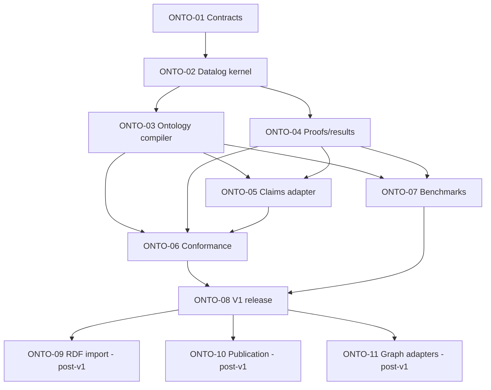

# Ontological reasoning epic

Parent: [#131](https://github.com/mylonasc/gestaltdb/issues/131).
Integration branch: **`onto-dev`**. Implementation PRs target this branch,
not `main`. This document is the implementation agreement, not a claim that
the APIs or features below have already shipped.

## Delivery status

- Epic and ONTO-01 through ONTO-11 child issues created; plan pushed to `onto-dev`.
- ONTO-01 implemented in [PR #143](https://github.com/mylonasc/gestaltdb/pull/143),
  targeting `onto-dev`; not yet integrated. Its contract tests pass on Python
  3.10-3.13, focused regressions pass, and documentation checks/build pass.
- ONTO-02 is the next implementation slice. ONTO-03 and ONTO-04 become parallel
  workstreams after the kernel interfaces and implementation land.

## Goal and decisions

Deliver a fast, small, portable ontology reasoner, decoupled from graph storage.
Use a standalone, pure-Python positive-Datalog kernel and a small ontology
compiler. No JVM integration is planned or supported. No new mandatory solver
dependency is required. Keep optional parser and solver integrations at the
boundary, not in the engine.

Datalog fits the existing positive Horn rules: safe rules, finite named-entity
domains, no function symbols, and bottom-up set-valued inference. Existing
`run_rules`, truth maintenance and explanations provide semantic precedents and
regression fixtures, but their evaluation currently lives inside `graphdb.py`
and mixes persistence, time and evidence with joins. Do not call that API from
the new engine or install generated ontology rules in the global rule catalog.
Leave existing rule APIs unchanged in v1; migrating them to the shared kernel
requires a later parity-driven change, not an incidental refactor.

The default backend is native Python. ONTO-07 compares it with the existing
evaluator, RDFLib/OWL-RL and Clingo before the v1 release decision. RDFLib/OWL-RL
is a useful optional oracle; Clingo is a mature optional Datalog/ASP execution
candidate, not itself an OWL implementation. Measure whole-pipeline costs,
including conversions and explanations. Do not assume an external engine is
faster or smaller. JVM-based reasoners are excluded even as optional adapters.

## Clear v1 boundary: `gestalt-core-v1`

Supported axioms:

- Named subclass and object-subproperty hierarchies.
- Named class/property equivalence as mutual implications.
- Object-property domain and range (type inference, not required-field checks).
- Inverse, symmetric and transitive object properties.

V1 supplies immutable ontology revisions, compiled programs, bounded closure,
read-only results, bounded explanations, and an explicit temporal-claims adapter.
Standalone callers can reason over ordinary Python facts without opening a DB.

Deferred: property chains, conjunction axioms, disjointness checks, equality and
`sameAs`, functionality/cardinality, literals/datatypes, anonymous existential
witnesses, negation, probabilistic rules, RDF import, materialization, incremental
deletion, current-graph projection, and query/sampling integration. This selected
fragment is **not** complete RDFS, OWL-RL, OWL-EL or OWL-DL.

### Semantic safeguards

- Open-world positive inference: missing facts are not false.
- Contradictions do not cause explosion. Explicit negatives do not participate
  in v1 closure; positive support remains usable even if also denied.
- No implicit node merging, cross-world joins, or propagation of confidence.
- A standalone fact batch is one context. Combining evidence is explicit.
- Adapters pin one valid-time point and one authenticated visible input prefix;
  results make no validity-interval or publication guarantee.
- Explicit world/agent/source policy; exclude recognized engine-produced claims
  by default. Derived evidence requires deliberate opt-in and policy identity.
- Deterministic set-valued logical closure, independent of duplicate evidence.
- Stable ontology revision, mapping, policy and input-context identities.
- Unsupported axioms fail before evaluation. No silent partial profile support.
- Exceeding an inference limit raises, rather than returning successful partial
  closure. Proof truncation is separately visible and does not invalidate closure.
- Bound inputs, rules, iterations, intermediate work, output facts and proof
  storage. These counters are not an exact process-RSS or wall-clock guarantee.

## Architecture and import direction

```text
ontology axioms -> compiler -> immutable Datalog program
                                      |
plain Python facts -------------------+-> evaluator -> result / proof DAG
                                      |
pinned GestaltDB claims -> adapter ----+
```

Proposed modules:

```text
gestaltdb/reasoning/model.py          facts, typed variables, rules, limits
gestaltdb/reasoning/protocols.py      fact-batch and evaluator interfaces
gestaltdb/reasoning/engine.py         standalone indexed delta evaluation
gestaltdb/reasoning/proofs.py         bounded shared explanations
gestaltdb/ontology/model.py           immutable axioms / revisions
gestaltdb/ontology/compiler.py        axiom compilation and rule origins
gestaltdb/reasoning/adapters/claims.py GestaltDB-specific extraction
```

Core reasoning and ontology modules use only the standard library and inward
reasoning interfaces. They must not import GraphDB, KV stores, serializers,
Cypher, sampling, temporal records or optional solvers. The core never calls a
database, reads a clock, writes files or publishes claims. Adapters own extraction,
time normalization, source policy, authenticated context and evidence identifiers.
Use typed variables, not strings whose `?` prefix changes their meaning.

Existing `gestaltdb.__init__` eagerly imports other subsystems. Architectural
decoupling does not claim to remove that existing import footprint or make the
engine independently installable. Separate packaging and package-root cleanup
are not v1 prerequisites. Add tests against *implementation* import regressions.

Proofs are finite shared DAGs, not enumerated proof trees. A bounded witness is
not sufficient for deletion maintenance: no such guarantee is made in v1.

## Indexed work packages

P0: foundation/correctness. P1: required v1 delivery. P2: post-v1 follow-up.
Each row owns a dedicated branch/worktree and a PR targeting `onto-dev`.

| ID | Priority | Issue | Deliverable | Depends on | Branch suffix |
| --- | --- | --- | --- | --- | --- |
| ONTO-01 | P0 | [#132](https://github.com/mylonasc/gestaltdb/issues/132) | Semantics, immutable contracts and adapter protocols | None | `contracts` |
| ONTO-02 | P0 | [#133](https://github.com/mylonasc/gestaltdb/issues/133) | Indexed delta-driven standalone Datalog kernel | 01 | `datalog` |
| ONTO-03 | P0 | [#134](https://github.com/mylonasc/gestaltdb/issues/134) | Immutable ontology model, identities and compiler | 02 | `compiler` |
| ONTO-04 | P0 | [#135](https://github.com/mylonasc/gestaltdb/issues/135) | Immutable lookups and bounded proof DAG | 02 | `proofs` |
| ONTO-05 | P1 | [#136](https://github.com/mylonasc/gestaltdb/issues/136) | Explicit pinned temporal-claims adapter | 03, 04 | `claims` |
| ONTO-06 | P0 | [#137](https://github.com/mylonasc/gestaltdb/issues/137) | Conformance, reference/differential and isolation tests | 03, 04, 05 | `conformance` |
| ONTO-07 | P1 | [#138](https://github.com/mylonasc/gestaltdb/issues/138) | Reproducible benchmark and solver decision | 03, 04 | `benchmarks` |
| ONTO-08 | P1 | [#139](https://github.com/mylonasc/gestaltdb/issues/139) | Public API, docs, examples, packaging/release gates | 06, 07 | `release` |
| ONTO-09 | P2 | [#140](https://github.com/mylonasc/gestaltdb/issues/140) | Optional strict/offline RDF import | 08 | `rdf` |
| ONTO-10 | P2 | [#141](https://github.com/mylonasc/gestaltdb/issues/141) | Explicit publication and support reconciliation | 08 | `publication` |
| ONTO-11 | P2 | [#142](https://github.com/mylonasc/gestaltdb/issues/142) | Current-graph/query/sampling adapters | 08 | `graph-adapters` |

Branch naming: `feature/onto-01-contracts`, etc. Numeric dependencies above refer
to ONTO IDs, not GitHub issue numbers. Acceptance checklists live in child issues.

### Dependency graph

Arrows mean prerequisite -> dependent. P2 items do not block v1.



## Parallel execution and integration

1. Land contracts, then the kernel. Commit and push coherent tested milestones.
2. Compiler and proof work can run in independent worktrees after ONTO-02.
3. Claims adaptation and benchmarking can run independently after 03/04.
   Conformance fixtures can be prepared against frozen interfaces earlier.
4. Central exports, package metadata and broad documentation belong to ONTO-08
   to reduce conflicts. Each slice owns its focused tests and developer docs.
5. Rebase/merge prerequisites deliberately; never silently code against a moving
   interface. Stacked branches are only for genuine prerequisite relationships.
6. Update child issues and #131 with branch/PR links and acceptance evidence.
7. Final release integration to `main` happens only after ONTO-08 gates pass.

Preserve unrelated worktrees and files. No force pushes to shared integration
branches. Keep optional benchmark tools out of runtime requirements. Never push
untested implementation merely to increase commit frequency.

## Release gates and risks

- Independent reference evaluator agrees with closure on generated small cases.
- Optional OWL-RL oracle checks only compatible consequences, not GestaltDB's
  temporal or conflict-tolerant semantics.
- Test constants, repeated variables, cycles, duplicate facts/evidence,
  independent support, resource failures, snapshot and world/source isolation.
- Measure initialization, extraction/conversion, compile, inference, proofs,
  peak RSS and package footprint with recorded versions and commands.
- Sparse hierarchies and dense transitive closures must both be measured;
  quadratic output cannot be optimized away. No unmeasured speed claims.
- Python 3.10-3.13 compatibility and no new mandatory dependency.
- Runnable standalone/claims examples and no regressions to existing rule APIs.

Publication is deferred because point-selected evidence does not justify broad
temporal intervals. Future interval closure needs disjoint unions of proof
intersections, not a min/max envelope. Future deletion maintenance must remove
self-supporting cycles. Equality needs snapshot-local canonicalization, proofs
and split/rebuild handling; it is not another ordinary predicate rule.

Related: #127 (hierarchical sampling integration), #126 (unified explanations),
#125 (negation), #124 (weighted rules), #130 (enhancement tracker). These are not
implicit dependencies or additions to the v1 scope.
