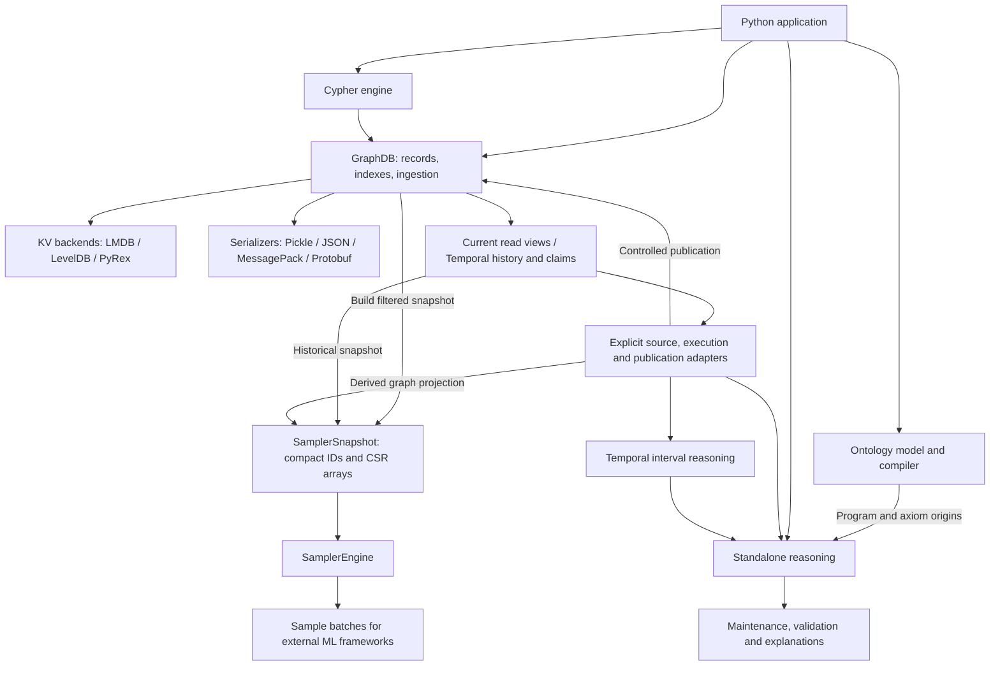

# GestaltDB


[](https://scorecard.dev/viewer/?uri=github.com/mylonasc/gestaltdb)
[](https://mylonasc.github.io/gestaltdb/)

**An embedded graph database toolkit for Python, combining fast ingestion and sampling with graph querying, knowledge representation, and logical reasoning.**

GestaltDB brings together persistent property graphs, **fast Arrow/Polars bulk ingestion**, **high-performance graph sampling**, and **indexed property-graph filtering**. Store attributed nodes and edges in LMDB, LevelDB, or RocksDB/PyRex; select the graph you need with labels, relationship types, properties, and Cypher; then reuse compact NumPy snapshots for ML training.

Ontology and reasoning components add semantic classification, temporal evidence, explanations, and maintenance of supported conclusions. Use these components independently or connect them through explicit application workflows.

Documentation: https://mylonasc.github.io/gestaltdb/

**Release status:** `0.14.0rc2` is the testing release candidate covering the
GraphDB service decomposition (#388), typed/temporal reasoning extensions and
explicit historical native locator admission. See the
[testing guide](docs/reasoning-testing.rst) for compatibility boundaries.

## Components and Applications

| Component | Interface and application value |
| --- | --- |
| **GraphDB and ingestion** | Load Python objects or Arrow/Polars columns, maintain indexes, and manage persistent entities and relationships. Useful for data integration, dependency graphs, and graph-backed applications. [Operations](docs/operations.rst) · [Bulk ingestion](#arrow-ingestion-example) |
| **KV backends and serializers** | Choose LMDB, LevelDB, or RocksDB/PyRex and an independent payload encoding. The nontransactional PyRex path provides native columnar writes for fast bulk loading. [Backends](docs/storage-backends.rst) · [Serializers](docs/serializers.rst) |
| **Cypher and graph exploration** | Query and mutate the property graph, filter application cohorts, and inspect results visually. [Cypher](docs/cypher.rst) · [Filtering](docs/property-filtering.rst) · [Visualization](docs/visualization.rst) |
| **Sampling engine** | Build a `SamplerSnapshot` once and reuse `SamplerEngine` for weighted/heterogeneous neighborhoods, walks, temporal sampling, and positive/negative examples for external ML frameworks. [Sampling guide](docs/typed-sampling.rst) |
| **Temporal and epistemic storage** | Record versioned graphs and sourced claims, with valid time, system time, knowledge worlds, and conflicting evidence. Useful for historical analysis and scientific evidence tracking. [Bitemporal history](docs/temporal-versioning.rst) · [Epistemic and modal queries](docs/modal-epistemic.rst) |
| **Ontology model and compiler** | Compile selected class/property axioms into rules with axiom origins, for semantic classification and relationship enrichment. [Ontology](docs/ontology.rst) · [Supported profiles](docs/reasoning-profiles.rst) |
| **Standalone reasoning and temporal reasoning** | Evaluate Datalog, selective goals, validation, and interval closure. Explicit support indexes maintain conclusions as evidence changes. [Typed rules](docs/reasoning-typed.rst) · [Temporal closure](docs/reasoning-temporal.rst) · [Maintenance](docs/reasoning-maintenance.rst) |
| **Reasoning adapters and saved state** | Map stored graph/claim data to facts; resume reasoning state, verify its source, publish inferred claims, or build derived sampling snapshots. [Sessions](docs/reasoning-sessions.rst) · [Range publication](docs/reasoning-bound-range-publication.rst) · [Inferred snapshots](docs/reasoning-authenticated-inferred.rst) |



Arrows show selected API calls and data handoffs, not automatic synchronization.
`GraphDB` is the integration hub; sampling and standalone reasoning have separate
execution interfaces. Read the [component and application architecture](docs/architecture.rst)
for the full decomposition, workflows, code links, and modularity boundaries.
For copyable, tested API examples, see [Runnable API Workflows](docs/api-workflows.rst).

### Scope and Caveats

- **Performance is workload-dependent.** Fast ingestion and repeated array-native sampling are key strengths. Account separately for index rebuilds, snapshot construction, loading, and inference. [Performance guidance](docs/performance.rst)
- **Semantics are explicit.** Selected ontology/rule fragments support classification, validation, and maintenance. Conflicting evidence can coexist; truth maintenance preserves supported conclusions rather than automatically resolving contradictions. [Profiles](docs/reasoning-profiles.rst)
- **History is recorded deliberately.** Historical queries use temporal versions and claims; ordinary mutable graph updates are a separate path. [Temporal versioning](docs/temporal-versioning.rst)
- **Source verification has a specific meaning.** An “authenticated” artifact is checked against expected database history and application-held identities. It is source/state verification, not login authentication or a guarantee that assertions are true. [Saved reasoning state](docs/reasoning-authenticated-sessions.rst)
- **Integration stays application-controlled.** Snapshots are rebuilt explicitly; reasoning and publication are explicit operations, and some changes require recomputation. ML training uses external frameworks; probabilistic rules and an automated feedback loop remain [#124](https://github.com/mylonasc/gestaltdb/issues/124) and [#128](https://github.com/mylonasc/gestaltdb/issues/128). Operational hardening scope is recorded in [#381](https://github.com/mylonasc/gestaltdb/issues/381).

## Filter, Sample, Train

| Capability | What you can do |
| --- | --- |
| **Property-graph filtering** | Exact/range lookups, label + property and relationship type + property indexes, ID-only candidate iteration, and Cypher predicates. |
| **Live graph sampling** | Directional typed neighbors, reservoir sampling, multi-hop typed paths, and materialized subgraphs. |
| **Array-native sampling** | Reusable CSR snapshots; node/edge seeds, uniform or weighted neighbors, heterogeneous layers, random/restart/metapath walks, multihop subgraphs, and hard negatives. |
| **Temporal sampling** | Authenticated history snapshots, point/window filters before fanout, causal multihop policies, and time-aware negative rejection. |

**Start here:** [Property-graph filtering](#property-graph-filtering-and-indexes) · [High-performance sampling](#high-performance-graph-sampling) · [Sampling guide](https://mylonasc.github.io/gestaltdb/typed-sampling.html) · [Filtering guide](https://mylonasc.github.io/gestaltdb/property-filtering.html) · [Performance and benchmarks](https://mylonasc.github.io/gestaltdb/performance.html).

## Install From PyPI

With pip:

```sh
python -m pip install gestaltdb
```

With uv:

```sh
uv add gestaltdb
```

Install columnar ingestion dependencies:

```sh
python -m pip install "gestaltdb[arrow,polars]"
```

Install only the backend and serializer you need. Extras are additive, so any
backend can be paired with any serializer without combination-specific extras:

```sh
python -m pip install "gestaltdb[leveldb,msgpack]"
python -m pip install "gestaltdb[lmdb,protobuf]"
python -m pip install "gestaltdb[rocksdb]"
```

Pickle and JSON serialization are built in. A base install intentionally does
not install an embedded KV backend. Install all backends and serializers with:

```sh
python -m pip install "gestaltdb[backends,serializers]"
```

`GraphDB.create()` keeps RocksDB/PyRex as its compatibility default, so a base
install must pass an installed backend explicitly and never silently falls back.

Install every optional integration, including ingestion and benchmark clients:

```sh
python -m pip install "gestaltdb[all]"
```

Optional extras include `lmdb`, `leveldb`, `rocksdb`, `backends`, `msgpack`, `protobuf`, `serializers`, `arrow`, `polars`, `fast-ingest`, `bloom`, `docs`, `dev`, and `all`.

## Basic Example

```python
from tempfile import TemporaryDirectory

from gestaltdb.graphdb import Edge, GraphDB, Node
from gestaltdb.kvstores import LevelDBStore
from gestaltdb.serializers import PickleSerializer

with TemporaryDirectory() as tmpdir:
    graph = GraphDB(LevelDBStore(path=f"{tmpdir}/graph"), PickleSerializer())

    graph.put_node(Node(node_id="alice", labels=["Person"], properties={"name": "Alice"}))
    graph.put_node(Node(node_id="bob", labels=["Person"], properties={"name": "Bob"}))
    graph.put_edge(Edge(
        edge_id="alice-knows-bob",
        source="alice",
        target="bob",
        properties={"type": "knows", "since": 2024},
    ))

    result = graph.query('MATCH (a:Person {name: "Alice"}) MATCH (a)-[:knows]->(b) RETURN a.id, b.name')
    print(result.records)

    graph.close()
```

## Property-Graph Filtering and Indexes

Labels and relationship types are indexed automatically; **property indexes are explicit**. Creating a property index also maintains its label/property or type/property composite forms—no separate composite-index declaration is needed.

With a populated graph, select application cohorts and strong relationships directly:

```python
graph.create_node_property_index("score")
graph.create_edge_property_index("confidence")

cohort = graph.nodes_by_label_property_range("Protein", "score", 0.8, None)
strong_edges = graph.edges_by_type_property_range("binds", "confidence", 0.9, None)

# Stream IDs instead of hydrating full Node objects when preparing a seed set.
seed_ids = list(graph.iter_node_ids_by_label_property_range("Protein", "score", 0.8, None))

result = graph.query(
    'MATCH (d:Drug)-[r:binds]->(p:Protein) '
    'WHERE p.score >= $score AND r.confidence >= $confidence '
    'RETURN d.id AS drug, p.id AS protein',
    {"score": 0.8, "confidence": 0.9},
)
```

Ranges include both bounds by default; use `None` for an unbounded end or `include_end=False` for an exclusive upper bound. Eligible Cypher predicates use configured indexes to select candidates; residual predicates are still checked. Arbitrary expressions are not all index-backed. Rebuild deferred indexes before index-backed reads.

**Filtering seeds is not filtering the traversed graph.** To restrict every sampled hop by properties, build a filtered snapshot with `node_filter`/`edge_filter`, as below. These callbacks run during a graph scan at build time—not inside the repeated sampling hot path and not as automatic index pushdown. See the [dedicated filtering guide](https://mylonasc.github.io/gestaltdb/property-filtering.html) for exact/range API tables, Cypher, and cohort-to-snapshot workflows.

## High-Performance Graph Sampling

Choose the sampling layer for your workload:

- **Live `GraphDB` traversal:** `sample_neighbors`, `sample_typed_paths`, and `sample_typed_subgraph` use typed adjacency and external IDs. Reservoir neighbor sampling bounds sample memory by fanout, but still scans the eligible adjacency.
- **Reusable `SamplerSnapshot` + `SamplerEngine`:** persist compact CSR arrays once, then draw repeated batches without KV reads or `Node`/`Edge` deserialization. Load with `mode="ram"` or `mode="memmap"`; keep compact IDs in the hot path and convert only at application boundaries.

### Filter a Property Graph, Then Sample It

This self-contained example needs `gestaltdb[lmdb]`. It keeps approved drugs, proteins, and high-confidence binding edges, then uses the same snapshot for weighted neighbors, layered sampling, and walks:

```python
from tempfile import TemporaryDirectory

from gestaltdb.graphdb import Edge, GraphDB, Node
from gestaltdb.sampling import ExternalNeighborSamplingSpec, SamplerEngine

with TemporaryDirectory() as tmpdir:
    graph = GraphDB.create(f"{tmpdir}/graph", backend="lmdb", serializer="json")
    try:
        graph.put_nodes([
            Node("drug-1", labels=["Drug"], properties={"approved": True}),
            Node("protein-1", labels=["Protein"]),
            Node("protein-2", labels=["Protein"]),
        ])
        graph.put_edges_bulk([
            Edge("e1", "drug-1", "protein-1", properties={"type": "binds", "confidence": 0.95}),
            Edge("e2", "drug-1", "protein-2", properties={"type": "binds", "confidence": 0.4}),
        ])
        snapshot = graph.build_sampler_snapshot(
            f"{tmpdir}/sampler",
            node_filter=lambda n: "Protein" in n.labels or n.properties.get("approved") is True,
            edge_filter=lambda e: e.properties.get("type") == "binds" and e.properties.get("confidence", 0) >= 0.9,
            edge_weight_property="confidence",
            read_snapshot=True,  # require a verifiable, coherent source snapshot
        )
    finally:
        graph.close()

    # Sampling no longer needs an open database. Reuse this engine across batches.
    engine = SamplerEngine.load(snapshot.path, mode="memmap", seed=7)
    sampled = engine.sample_neighbors_external(
        ["drug-1"], fanout=10, relations=["binds"], strategy="weighted",
    )
    assert sampled.to_external(engine.snapshot)["neighbor_nodes"].tolist() == ["protein-1"]
    layers = engine.sample_layers_external(
        ["drug-1"], [ExternalNeighborSamplingSpec(10, relations=["binds"])],
    )
    walks = engine.sample_random_walks_external(["drug-1"], 2, metapath=["binds"])
```

The engine also supports node/edge seed sampling, multihop expansion, positive triples, hard negatives, and temporal point/window filtering. Layer and walk policies support direction/relation filters; layers have independent fanouts, and walks support restart and dead-end policies. Layer results are array blocks, not framework-native PyG/DGL message-passing objects.

**Performance model:** amortize snapshot construction over many batches; benchmark construction, loading, and sampling separately. `memmap` reduces eager array loading but does not eliminate RAM use: candidate/result buffers, metadata, and positive-membership structures still allocate memory. Snapshot construction scans and materializes data; it is not an out-of-core ingestion pipeline. There is no universal speedup claim. See [sampling performance guidance and reproducible benchmark commands](https://mylonasc.github.io/gestaltdb/performance.html#sampling-and-filtering-performance).

See the [full sampling guide](https://mylonasc.github.io/gestaltdb/typed-sampling.html) for the API matrix, compact/local/external IDs, weighted draws, temporal semantics, and negative-sampling examples.

## Arrow Ingestion Example

This example ingests entity columns from PyArrow arrays. `JSONSerializer` lets GestaltDB build node and edge payloads from structured columns.

```python
from tempfile import TemporaryDirectory

import pyarrow as pa

from gestaltdb.graphdb import GraphDB
from gestaltdb.kvstores import LevelDBStore
from gestaltdb.serializers import JSONSerializer
from gestaltdb import IndexMaintenanceMode

with TemporaryDirectory() as tmpdir:
    graph = GraphDB(LevelDBStore(path=f"{tmpdir}/graph"), JSONSerializer())

    graph.create_node_property_index("name")

    result = graph.ingest_arrow(
        pa.array(["alice", "bob", "carol"]),
        pa.array(["alice-knows-bob", "bob-knows-carol"]),
        pa.array(["alice", "bob"]),
        pa.array(["bob", "carol"]),
        pa.array(["knows", "knows"]),
        labels=pa.array([["Person"], ["Person"], ["Person"]]),
        node_properties={"name": pa.array(["Alice", "Bob", "Carol"]), "age": pa.array([34, 36, 29])},
        edge_properties={"since": pa.array([2024, 2025])},
        index_mode=IndexMaintenanceMode.DEFER_REBUILD,
    )
    print(result)  # {'nodes': 3, 'edges': 2, 'rebuilt_indexes': ..., 'stale_indexes': ()}

    result = graph.query('MATCH (a:Person {name: "Alice"}) MATCH (a)-[:knows]->(b) RETURN a.id, b.name')
    print(result.records)

    graph.close()
```

## Polars Ingestion Example

This example ingests the same graph from Polars DataFrames. Property columns are converted into node and edge payloads during ingestion.

```python
from tempfile import TemporaryDirectory

import polars as pl

from gestaltdb.graphdb import GraphDB
from gestaltdb.kvstores import LevelDBStore
from gestaltdb.serializers import JSONSerializer
from gestaltdb import IndexMaintenanceMode

nodes = pl.DataFrame({
    "node_id": ["alice", "bob", "carol"],
    "labels": [["Person"], ["Person"], ["Person"]],
    "name": ["Alice", "Bob", "Carol"],
    "age": [34, 36, 29],
})

edges = pl.DataFrame({
    "edge_id": ["alice-knows-bob", "bob-knows-carol"],
    "source": ["alice", "bob"],
    "target": ["bob", "carol"],
    "edge_type": ["knows", "knows"],
    "since": [2024, 2025],
})

with TemporaryDirectory() as tmpdir:
    graph = GraphDB(LevelDBStore(path=f"{tmpdir}/graph"), JSONSerializer())
    graph.create_node_property_index("name")

    graph.ingest_polars(
        nodes,
        edges,
        node_property_columns=["name", "age"],
        edge_property_columns=["since"],
        index_mode=IndexMaintenanceMode.DEFER_REBUILD,
    )

    result = graph.query('MATCH (a:Person) MATCH (a)-[:knows]->(b) RETURN a.name, b.name ORDER BY a.name')
    print(result.records)

    graph.close()
```

## Install From A Checkout

From a local checkout:

```sh
uv sync
```

Install into another project:

```sh
uv add /path/to/gestaltdb
```

With pip:

```sh
python -m pip install /path/to/gestaltdb
```

## Backend and Ingestion Recommendations

For the current library:

- Use `LevelDBStore` for small local graphs, examples, and straightforward embedded use.
- Use `PyRexStore`/RocksDB for large append-only loads and Arrow/Polars columnar ingestion.
- Use `LMDBStore` when LMDB's storage model is desirable and you can size `map_size` ahead of loading.
- Use `JSONSerializer` with `GraphDB.ingest_polars` or `GraphDB.ingest_arrow` when input data is already tabular and JSON-compatible.
- Use pre-serialized `node_value` and `edge_value` columns when upstream data already has serializer-compatible payload bytes.
- Keep `IndexMaintenanceMode.MAINTAIN` for incremental writes that need indexes ready immediately.
- Use `IndexMaintenanceMode.DEFER` or `DEFER_REBUILD` for bulk loads when you want to move secondary-index work out of the write path.

Measured locally on 100k nodes and 500k edges, RocksDB native columnar ingestion was `1.16x` faster end-to-end than LevelDB on the same Python JSON payload path, and Polars JSON payload construction was `1.86x` faster than Python JSON serialization. Deferred indexing made the write phase `8.72x` faster, but immediate full rebuild made total ingest-plus-rebuild `17.2%` slower for that subset. Treat these as workload-specific guidance and benchmark your graph shape, serializer, and indexes.

## Features

- Attributed `Node` and `Edge` objects with stable IDs.
- Native node labels and typed edge traversal through `edge.properties["type"]`.
- LMDB, LevelDB, and RocksDB/PyRex storage backends.
- Pickle, JSON, MessagePack, and Protobuf serializers.
- Indexed property-graph filtering by labels, relationship types, exact values, and ranges, with ID-only candidate iterators.
- Grammar-based Cypher read/write subset with indexed scans, paths, read composition, aggregation, constraints, schema introspection, and registered procedures.
- Bulk and columnar ingestion helpers for Arrow and Polars.
- Live typed neighbor/path/subgraph sampling plus reusable array-native seed, weighted-neighbor, layered, walk, and hard-negative sampling in RAM or memmap mode.
- Filtered property-graph snapshots and temporal point/window/causal sampling policies.

See the full documentation for backend selection, indexing, Cypher syntax, ingestion, sampling, and benchmarks.

## Dependency Vulnerability Scan

Run the Docker-based Trivy scan for the cartesian product of KV backends
(`leveldb`, `lmdb`, `rocksdb`) and serializers (builtin JSON/Pickle as `json`,
plus `msgpack` and `protobuf` extras) — 9 locked runtime sets:

```sh
./scripts/scan_backend_vulnerabilities.sh
```

The script exports locked production dependencies in a `uv` container and writes table and JSON reports to `security-reports/` as `<backend>-<serializer>.json/txt` (for example `leveldb-msgpack.json`). Development and documentation dependencies are excluded. Set `FAIL_ON_SEVERITY=HIGH,CRITICAL` to return a nonzero status when policy-level findings are present.

<details>
<summary>Name origin</summary>

The name GestaltDB is inspired by Gestalt psychology and the idea that the whole is something more than its parts.

</details>
