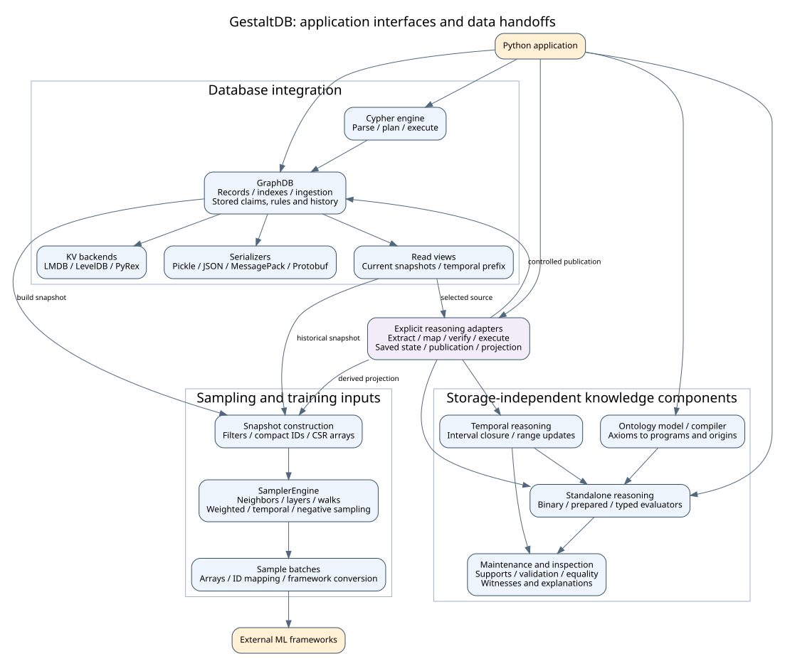

Components, Interfaces, and Applications
========================================

GestaltDB combines an embedded graph database, **fast bulk ingestion**, and a
**high-performance graph-sampling engine** with ontology and reasoning
components. Applications can store and explore connected data, prepare training
batches, classify entities, or maintain conclusions from changing evidence.
Explicit adapters connect these workflows without requiring every graph
operation to perform inference.

This is a map of application-facing responsibilities, not a claim that each box
is an independently deployed service. ``GraphDB`` is the database integration
hub; sampling and standalone reasoning expose their own execution interfaces.

   Selected API calls and data handoffs. Applications choose when to build
   snapshots, run reasoning, advance saved state, and publish results.

Component responsibilities
---------------------------

Database, ingestion, and queries
~~~~~~~~~~~~~~~~~~~~~~~~~~~~~~~~

``gestaltdb.graphdb.GraphDB`` manages nodes, directed edges, labels, indexes,
and mutations. ``put_node`` / ``put_edges_bulk`` accept graph objects;
``ingest_arrow`` / ``ingest_polars`` accept columns with explicit payload and
index-maintenance policies. The nontransactional PyRex backend offers a native
columnar writer for bulk-loading workloads. This is useful for importing
customer/product networks, scientific interaction data, and dependency graphs.
See :doc:`operations`, :doc:`property-filtering`, and :doc:`performance`.

``gestaltdb.kvstores.KVStore`` separates persistence from the graph API through
LMDB, LevelDB, and PyRex/RocksDB implementations. The independently selected
``Serializer`` encodes graph payloads using Pickle, JSON, MessagePack, or
Protobuf. Transaction and read-snapshot capabilities vary by backend; see
:doc:`storage-backends` and :doc:`serializers` when choosing deployment behavior.

``GraphDB.query`` calls the Cypher parser, planner, and runtime and returns a
``QueryResult``. It supports relationship exploration, cohort selection, and
graph mutations. Visualization builders consume graph/query/sample results
through a bounded graph representation for HTML or SVG output. Follow
:doc:`cypher` and :doc:`visualization` for application examples.

Sampling engine
~~~~~~~~~~~~~~~~

``SamplerSnapshot`` is the bridge from graph records to compact integer IDs,
NumPy arrays, and compressed sparse row (CSR) adjacency. Build a filtered
snapshot once, then reuse ``SamplerEngine`` for fast repeated batches without
per-batch database reads and graph-object deserialization. The database can be
closed after construction. A snapshot is immutable; applications explicitly
build another when they want to include source changes.

Inputs are seed IDs and sampling policies; outputs are array-backed neighbor,
layer, walk, subgraph, and positive/negative batches. External-ID mappings and
framework conversion helpers form the boundary to external ML training code.
Neighborhood, heterogeneous, weighted, temporal, and negative sampling support
GNN training, link prediction, recommendation, and embeddings. See
:doc:`typed-sampling`, :doc:`sampling-consistency`, and :doc:`property-filtering`.
Measure snapshot build/load costs separately from repeated sampling; RAM and
memory-mapped loading have different costs (:doc:`performance`).

Temporal history and epistemic claims
~~~~~~~~~~~~~~~~~~~~~~~~~~~~~~~~~~~~~

Temporal storage lives alongside mutable graph records in ``GraphDB``.
``put_node_version``, ``put_edge_version``, and ``commit_versions`` record
history; ``assert_claim``, correction, and retraction APIs record sourced
propositions. The interfaces exchange immutable version records rather than
silently converting every ordinary mutation into history.

**Valid time** describes when an assertion applies. **System time** describes
when it was recorded in the database history. For example, a supplier status
valid last month may be corrected today: an application can inspect both the
revised account of last month and the account available before the correction.
See :doc:`temporal-versioning` for version writes, half-open validity intervals,
historical reads, and bitemporal Cypher queries.

``read_view`` selects a valid-time point and visible commit prefix;
``current_read_view`` pins mutable graph state where the backend supports it.
They are different interfaces, suited respectively to historical evidence and
coherent current-graph analysis. Their source identities stay distinct.

Claims carry agent/source attribution, a world, polarity, and optional
confidence/provenance. Positive and negative evidence may coexist; claim status
distinguishes supported, refuted, both, and unknown. The bounded modal API
evaluates belief/knowledge formulas over explicit accessibility links. For
multi-source scientific knowledge or agent belief models, see
:doc:`modal-epistemic`. Model-output provenance can be included in historical
explanations through :doc:`inference-audit`.

Ontology model and compiler
~~~~~~~~~~~~~~~~~~~~~~~~~~~

``Ontology`` holds semantic axioms; ``compile_ontology`` produces a
``CompiledOntology`` containing a binary reasoning ``Program`` and exact axiom
origins. Supported constructs include class/property hierarchies, domain/range,
inverse, symmetric and transitive properties, and selected chains and class
expressions. This separation lets an application compile a shared semantic
model and evaluate it against explicitly selected facts.

For entity classification and relationship enrichment, start with
:doc:`ontology`. The offline RDF adapter provides an optional import boundary.
Separate validation and snapshot-local equality mechanisms have their own
contracts (:doc:`reasoning-validation`, :doc:`reasoning-equality`). Consult
:doc:`reasoning-profiles` for the supported construct matrix rather than
assuming a complete OWL profile.

Standalone reasoning, maintenance, and temporal reasoning
~~~~~~~~~~~~~~~~~~~~~~~~~~~~~~~~~~~~~~~~~~~~~~~~~~~~~~~~~

The storage-independent ``reasoning`` package consumes programs and facts.
The binary engine uses ``Program`` / ``Fact`` and can collect bounded witnesses;
the typed engine uses ``GenericProgram`` / ``TypedFact`` for n-ary relations,
strict literals, filters, scoped negation, and selected aggregation. Prepared
plans and optional execution paths have explicit compatibility contracts.
See :doc:`reasoning-execution`, :doc:`reasoning-typed`,
:doc:`reasoning-negation`, and :doc:`reasoning-executors`.

Goal-directed APIs answer selective questions rather than requiring applications
to request every consequence (:doc:`reasoning-demand`, :doc:`reasoning-frontier`).
Support/dependency indexes and DRed-style deletion maintain conclusions when
supporting facts change (:doc:`reasoning-maintenance`). Validation reports
conflicts without rewriting the fact set; explanation APIs expose bounded
derivations with different witness/support contracts (:doc:`reasoning-proofs`).

**Temporal storage and temporal reasoning are separate responsibilities.**
``TemporalFact`` / ``IntervalSet`` and ``evaluate_range`` compute the intervals
over which conclusions follow. ``update_range`` reuses eligible segment
computations; ``verify_closure`` checks conformance. This enables questions such
as "during which periods did this dependency or eligibility rule hold?"
Recording versions alone does not execute interval reasoning. See
:doc:`reasoning-temporal`, :doc:`reasoning-ranges`, and
:doc:`reasoning-conformance`.

Explicit integration adapters
~~~~~~~~~~~~~~~~~~~~~~~~~~~~~~

``reasoning.adapters`` connects the database and standalone logic layers:

* **Read and map:** select graph records or temporal claims, map them to facts,
  and retain the selected source context and evidence references.
* **Verify and execute:** check database/history, program, policy, and
  representation compatibility before using a generation.
* **Save and resume:** persist reasoning state and apply committed evidence
  changes through supported incremental operations or an explicit rebuild.
* **Publish and project:** write inferred claims under controlled publication
  rules or turn derived relationships into reusable sampler snapshots.

A **reasoning session** is the saved state of a particular reasoning
computation: its program/catalog, source scope and horizon, evidence ledger,
facts, and support index. It is not a user login or a database connection.
An **authenticated** result/artifact is source-verified: checked against the
expected database history and application-held identities. This checks source
and state correspondence; the relevant execution APIs separately define how
closure is recomputed or verified.

Use :doc:`ontology-graph` and :doc:`reasoning-current-admission` for current
property graphs; :doc:`reasoning-generation-identity` for typed-point evidence;
:doc:`reasoning-sessions` and :doc:`reasoning-authenticated-sessions` for saved
state; :doc:`reasoning-range-admission` and :doc:`reasoning-bound-range-publication`
for finite intervals; and :doc:`reasoning-authenticated-inferred` for derived
sampling snapshots.

Choose an application workflow
-------------------------------

.. list-table:: From application goal to component interfaces
   :header-rows: 1
   :widths: 24 40 36

   * - Application
     - Component handoff
     - Start here
   * - Explore a dependency or customer network
     - Ingest -> GraphDB/indexes -> Cypher -> visualization
     - :doc:`quickstart`, :doc:`operations`, :doc:`cypher`, :doc:`visualization`
   * - Train a link predictor or recommender
     - Ingest -> filter graph -> snapshot -> sampler -> external ML framework
     - :doc:`property-filtering`, :doc:`typed-sampling`, :doc:`performance`
   * - Classify entities with an ontology
     - Ontology -> compiler -> program; selected graph/claims -> adapter -> evaluator
     - :doc:`ontology`, :doc:`ontology-graph`, :doc:`reasoning-validation`
   * - Audit historical eligibility or evidence
     - Versioned claims -> pinned history -> temporal closure -> explanations/publication
     - :doc:`temporal-versioning`, :doc:`reasoning-temporal`, :doc:`reasoning-bound-range-publication`
   * - Maintain conclusions as evidence changes
     - Committed versions -> session ledger -> maintenance -> saved state or publication
     - :doc:`reasoning-sessions`, :doc:`reasoning-authenticated-sessions`
   * - Inspect decisions based on model predictions
     - External model -> tagged claims -> stored rules -> inference audit export
     - :doc:`inference-audit`, :doc:`modal-epistemic`

Code navigation and modularity
-------------------------------

The main source entry points are ``graphdb.py`` (public facade),
``_graph/`` (private implementation collaborators), ``kvstores.py``,
``serializers.py``, ``readview.py``, ``sampling/``, ``ontology/``,
``reasoning/``, ``reasoning/adapters/``, ``query_engine/cypher/``, and ``viz/``
under ``src/gestaltdb``. :doc:`api` exposes documented APIs and source links;
:doc:`api-workflows` collects runnable docstring examples for the main handoffs.
Browse the `database implementation <https://github.com/mylonasc/gestaltdb/blob/main/src/gestaltdb/graphdb.py>`_,
`sampling components <https://github.com/mylonasc/gestaltdb/tree/main/src/gestaltdb/sampling>`_,
`ontology compiler <https://github.com/mylonasc/gestaltdb/blob/main/src/gestaltdb/ontology/compiler.py>`_,
and `reasoning components and adapters <https://github.com/mylonasc/gestaltdb/tree/main/src/gestaltdb/reasoning>`_
to follow those boundaries in code.

Historical consumers can use ``graph.history`` (``gestaltdb.history.TemporalHistory``)
instead of accepting the full mutable database. ``TemporalHistory.from_store``
also borrows an existing backend and serializer without constructing a
``GraphDB``. This capability exposes only historical reads, does not own the
store, and performs no identity initialization or index repair. It is not a
snapshot or an authenticated source: use ``graph.read_view`` for authenticated
fixed-horizon selection. ``GraphReadView`` delegates historical queries to this
capability; its source verification and sampler integration still retain the
owning graph. Temporal writes and publication remain behind the guarded facade.

For example, pass only read authority to an application component::

    from tempfile import TemporaryDirectory
    from gestaltdb.graphdb import GraphDB, Node

    def names_at(history, instant):
        return [v.logical_id for v in history.iter_nodes_as_of(valid_time=instant)]

    with TemporaryDirectory() as root:
        graph = GraphDB.create(root + "/db", backend="lmdb")
        try:
            graph.put_node_version(Node("alice"), valid=(0, 10))
            assert names_at(graph.history, 5) == ["alice"]
        finally:
            graph.close()

File coordination lives in ``gestaltdb.concurrency`` rather than in GraphDB.
The shared default ``LockManager`` maintains canonical identity only for live
locks (holders and waiters retain strong references); unused paths are
reclaimed. Identity initialization, temporal writers and durable-session CAS
use the same reentrant file-lock abstraction. Lock files themselves are never
unlinked, and independent processes still coordinate through OS file locks.

The decomposition is useful, with four important boundaries:

* ``GraphDB`` is the public integration facade: it owns handle lifecycle,
  transaction/snapshot scope binding, and thin method delegation. The
  implementation lives in cohesive private collaborators under
  ``src/gestaltdb/_graph/`` (entities, typed adjacency, secondary indexes,
  columnar ingestion, temporal history/commit/selection, claims, stored
  rules, sampling, lifecycle, scope binding). Ingestion, temporal writes,
  stored claims/rules, live traversal, and modal queries are responsibilities
  behind that facade rather than separately deployable engines.
* ``GraphDB.run_rules`` / ``maintain_truth`` evaluate stored temporal claims.
  Standalone Datalog evaluators use their own programs, facts, supports, and
  adapters. These are two rule-execution families with different interfaces.
* Inside standalone reasoning, temporal closure and maintenance reuse private
  typed-engine helpers. Binary, typed, prepared, and Polars paths have distinct
  capabilities. A diagram box does not imply universal executor substitution.
* Adapters use database internals for source identity, writer coordination,
  and commit validation. Package initializers also re-export multiple subsystems:
  logical independence is not an isolated-import or separate-distribution promise.

Scope and caveats
------------------

Fast ingestion and sampling are workload-oriented strengths. Snapshot building,
index rebuilding, source verification, conversion, and inference incur separate
costs (:doc:`performance`). Applications choose synchronization points and handle
explicit rebuilds when incremental operations do not apply.

Conflict-tolerant evidence and truth maintenance preserve supported conclusions;
they do not automatically resolve contradictions. Broader OWL coverage,
signed-denial premises, datatype shapes, and reusable TBox closure remain gated
or deferred (:doc:`reasoning-profiles`). External frameworks perform model
training. Weighted-rule semantics and an automated neuro-symbolic loop remain
tracked in `#124 <https://github.com/mylonasc/gestaltdb/issues/124>`_ and
`#128 <https://github.com/mylonasc/gestaltdb/issues/128>`_. Operational guarantees
follow the selected backend and documented coordination scope; the reliability
record is `#381 <https://github.com/mylonasc/gestaltdb/issues/381>`_.
