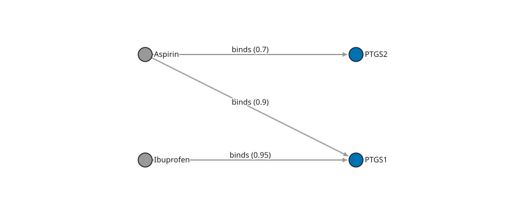

Query and Mutate with Cypher
============================

Use Cypher when the task is a graph pattern or a row pipeline rather than one
known-ID lookup. ``GraphDB.query`` returns ``QueryResult`` with ``columns`` and
``records``; iteration yields row dictionaries. Parameters supply values without
interpolating them into query text. See :doc:`data-access` for direct lookup and
loading alternatives, and :doc:`cypher` for the detailed supported syntax.

Read a pattern and aggregate its rows
--------------------------------------

**Standalone runnable example.** Install ``gestaltdb[lmdb]``. This small graph has
two drugs and two proteins. The pattern binds a drug, a directed ``binds`` edge,
and its protein endpoint; ``WHERE`` filters the bound rows.

   The tutorial's stored graph, generated by ``visualize_nodes_edges``. All three
   edges are shown; the first query below selects only Aspirin's PTGS1 target
   when the minimum score is 0.8.

.. code-block:: python

   from tempfile import TemporaryDirectory
   from gestaltdb.graphdb import Edge, GraphDB, Node

   with TemporaryDirectory() as root:
       with GraphDB.create(f"{root}/graph", backend="lmdb", serializer="json") as graph:
           graph.put_nodes([
               Node("d1", labels=["Drug"], properties={"name": "Aspirin"}),
               Node("d2", labels=["Drug"], properties={"name": "Ibuprofen"}),
               Node("p1", labels=["Protein"], properties={"name": "PTGS1"}),
               Node("p2", labels=["Protein"], properties={"name": "PTGS2"}),
           ])
           graph.put_edges_bulk([
               Edge("e1", "d1", "p1", properties={"type": "binds", "score": 0.9}),
               Edge("e2", "d1", "p2", properties={"type": "binds", "score": 0.7}),
               Edge("e3", "d2", "p1", properties={"type": "binds", "score": 0.95}),
           ])
           graph.create_node_property_index("name")
           hits = graph.query(
               "MATCH (d:Drug {name: $name})-[r:binds]->(p:Protein) "
               "WHERE r.score >= $minimum RETURN p.name AS protein",
               parameters={"name": "Aspirin", "minimum": 0.8},
           )
           assert hits.columns == ("protein",)
           assert hits.records == [{"protein": "PTGS1"}]

           counts = graph.query(
               "MATCH (d:Drug)-[r:binds]->(p:Protein) WHERE r.score >= $minimum "
               "WITH d.name AS drug, count(p) AS targets "
               "RETURN drug, targets ORDER BY drug",
               parameters={"minimum": 0.8},
           )
           assert counts.records == [
               {"drug": "Aspirin", "targets": 1},
               {"drug": "Ibuprofen", "targets": 1},
           ]

Read the relationship pattern as a conjunction: a matching drug **and** an
outgoing edge of type ``binds`` **and** a matching protein. This is a physical
property-graph match, not a Datalog rule that publishes new conclusions. Parallel
edges may produce separate rows. Use ``DISTINCT`` explicitly when distinct logical
values, rather than relationship occurrences, are intended.

``WITH`` replaces the available variable scope with its projections. Here it
groups by the non-aggregate ``drug`` output and computes a count per group.
``ORDER BY`` makes the expected row order explicit. Property indexes can accelerate
eligible entry predicates; a computed expression or arbitrary join need not use
every applicable index. See :doc:`property-filtering` for setup and freshness.

Write, constrain, and inspect
------------------------------

**Standalone runnable example.** Requires ``gestaltdb[lmdb]``. It creates a
single-property uniqueness constraint, writes one node, and updates it using a
parameterized match. The explicit transaction groups the two data queries.

.. code-block:: python

   from tempfile import TemporaryDirectory
   from gestaltdb.graphdb import GraphDB

   with TemporaryDirectory() as root:
       with GraphDB.create(f"{root}/graph", backend="lmdb", serializer="json") as graph:
           graph.query("CREATE CONSTRAINT drug_name FOR (d:Drug) REQUIRE d.name IS UNIQUE")
           with graph.transaction() as tx:
               tx.query("CREATE (d:Drug {id: $id, name: $name}) RETURN d.id AS id",
                        parameters={"id": "d1", "name": "Aspirin"})
               changed = tx.query(
                   "MATCH (d:Drug {name: $name}) SET d.approved = true "
                   "RETURN d.approved AS approved",
                   parameters={"name": "Aspirin"},
               )
               assert changed.records == [{"approved": True}]
           assert graph.get_node("d1").properties["approved"] is True
           assert len(graph.query("SHOW CONSTRAINTS").records) == 1
           graph.create_node_property_index("name")
           assert graph.query("SHOW INDEXES").records

``CREATE`` generates fresh IDs unless supplied as shown. ``MERGE`` provides an
explicit match-or-create operation; it is not the same as always creating a new
node. Other supported write forms include ``SET``, ``REMOVE``, ``DELETE`` /
``DETACH DELETE`` and ``FOREACH``. See :doc:`cypher` for exact syntax and scope.

Constraints currently cover single-property node uniqueness and required values
on **Cypher writes**, not universal validation of direct object writes. Transaction
guarantees depend on the selected backend; the LMDB example is not a promise of
graph-wide transactions on LevelDB or plain PyRex (:doc:`storage-backends`).
Source read snapshots do not make writes atomic across an arbitrary application
workflow.

Temporal scalar values versus historical queries
-------------------------------------------------

**Standalone runnable example.** Requires ``gestaltdb[lmdb]``. A temporal scalar
constructor creates a property/expression value. A valid-time qualifier selects
immutable version history, not the mutable current graph.

.. code-block:: python

   from tempfile import TemporaryDirectory
   from gestaltdb.graphdb import GraphDB, Node

   with TemporaryDirectory() as root:
       with GraphDB.create(f"{root}/graph", backend="lmdb", serializer="json") as graph:
           scalar = graph.query(
               "UNWIND [1] AS seed RETURN date($day) AS day",
               parameters={"day": "2024-01-02"},
           )
           assert scalar.records[0]["day"].value.isoformat() == "2024-01-02"
           graph.temporal.put_node_version(
               Node("d1", labels=["Drug"], properties={"name": "Aspirin"}), valid=(0, 10),
           )
           historical = graph.query(
               "MATCH (d:Drug) FOR VALID_TIME AS OF datetime($at) RETURN d.name AS name",
               parameters={"at": "1970-01-01T00:00:00.000005Z"},
           )
           assert historical.records == [{"name": "Aspirin"}]
           assert graph.get_node("d1") is None  # version writes are separate

The version-write integers are UTC-microsecond valid-time instants, not day
numbers. The query qualifier must evaluate to a ``datetime()``/``TemporalInstant``
value; a bare integer is not a valid Cypher qualifier. Add ``FOR SYSTEM_TIME AS OF``
to select a recorded-history horizon under
the bitemporal contract. Qualified queries are read-only and their context is
query-wide; see the timeline in :doc:`temporal-introduction`, the shared-horizon
workflow in :doc:`temporal-reads` and the temporal section of
:doc:`cypher`. Neither a scalar constructor nor a historical ``MATCH`` runs
interval Datalog (:doc:`reasoning-temporal`).

Capability map and boundaries
------------------------------

.. list-table:: Progress from the tutorial to the reference
   :header-rows: 1
   :widths: 28 42 30

   * - Need
     - Supported route
     - Boundary
   * - Explore paths
     - Fixed/variable-length and shortest paths, path bindings and accessors
     - Trail and shortest-path semantics are explicit; not GQL quantified paths.
   * - Compose results
     - Chained ``MATCH``, ``OPTIONAL MATCH``, ``WITH``, ``UNWIND``, ``UNION`` and correlated ``CALL``
     - Clause-local filtering, nulls and variable scope matter.
   * - Compute values
     - Documented scalar/temporal functions, expressions and aggregates
     - No arbitrary Python dispatch or unrestricted function catalogue.
   * - Inspect schema
     - ``SHOW INDEXES``, ``SHOW CONSTRAINTS``; node constraints
     - No relationship/multi-property constraints or direct-write enforcement.
   * - Call a procedure
     - ``pg.sample_typed_paths`` and ``kg.entails``
     - Only registered names/fields execute; ``kg.entails`` is bounded.
   * - Read inferred facts
     - Explicit generation-pinned :doc:`reasoning-queries`
     - Smaller read-only projection, not automatic inference in ordinary Cypher.

Pattern comprehensions, pattern arguments to ``exists()``, unregistered procedures
and unrestricted Cypher/GQL compatibility are not supported. Syntax/semantic errors
are source-located ``ValueError`` subclasses. Read-only queries automatically pin
current state where supported; ``read_snapshot=True`` requires that guarantee and
fails on unsupported backends. Refer to :doc:`cypher` for the complete documented
subset and :doc:`storage-backends` for backend-qualified behavior.
