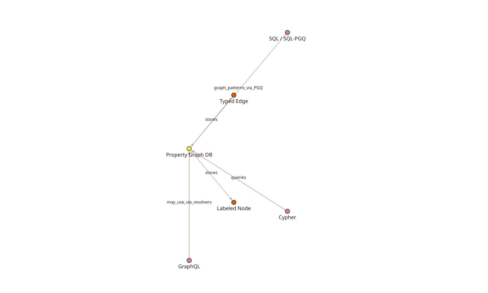
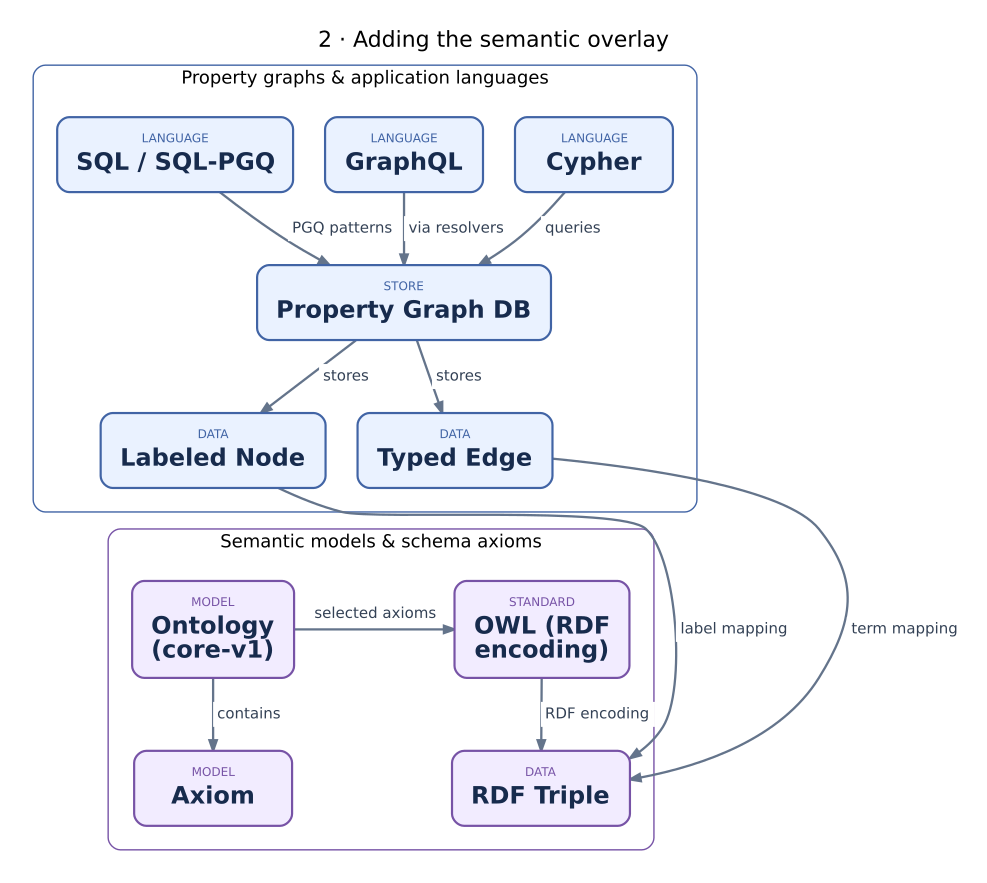
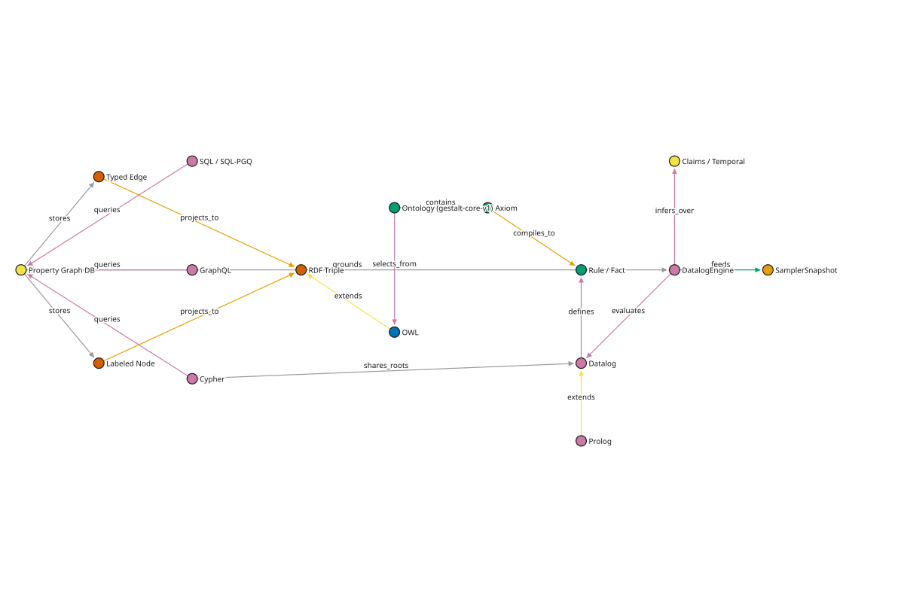

Property graphs vs semantic graphs
==================================

**Intuition first.** Picture a whiteboard: sticky notes for things
(``alice``, ``acme``), arrows between them labeled ``worksFor``. That is a
*property graph* — gestaltdb's home turf (``src/gestaltdb/graphdb.py``):
``Node`` objects carry native labels, ``Edge`` objects carry their
relationship in the ``properties["type"]`` convention. Now lay *tracing paper*
over the whiteboard and copy every arrow as a uniform triple
``(subject, predicate, object)``; write class membership as just another
arrow, ``(alice, rdf:type, Researcher)``. That tracing is the *semantic*
view. This tutorial's recurring diagram — built with gestaltdb's own viz
(``gestaltdb.viz.api`` → ``save_svg``) from a real ``Node``/``Edge`` graph in
``toolkit/landscape.py`` — maps how the two views and their languages relate.
It grows in three stages; node color is the concept kind, arrow labels are
the relationships.

Stage 1 — the property-graph world
----------------------------------

   Stage 1: the store and its query languages.

``Property Graph DB`` *stores* labeled nodes and typed edges. Three language
families *query* it: **Cypher** (pattern matching, gestaltdb's language —
see :doc:`../cypher`), **GraphQL** (client-shaped selection over graph APIs),
**SQL / SQL-PGQ** (relational engine with graph pattern extensions).
Intuition: the store is the whiteboard; the languages are different hands
pointing at it — same drawing, different gestures. Nothing here says what an
arrow *means*; ``worksFor`` is just a label.

Stage 2 — the semantic overlay
------------------------------

   Stage 2: projecting the whiteboard onto tracing paper.

Property nodes/edges *project to* **RDF triples** — the W3C lingua franca
where everything, including class membership, is a triple with IRIs.
**OWL** *extends* RDF with a vocabulary for saying what arrows mean
(subclasses, domains, inverses, transitivity). A gestaltdb **Ontology**
*selects from* OWL a small decidable fragment (``PROFILE =
"gestalt-core-v1"``) and *contains* **Axioms** — see
:doc:`ch02-ontology-fragment`. Intuition: the tracing paper doesn't replace
the whiteboard; it is an explicit, lossy-but-uniform copy. The projection is
caller-owned (``ontology/adapters/rdf.py`` is strict offline import, and
unsupported OWL is rejected, never approximated).

Stage 3 — the reasoning layer
-----------------------------

   Stage 3: an assistant that fills in the missing arrows.

Axioms *compile to* **Rules** over **Facts**; **Datalog** *defines* that rule
shape (safe, function-free Horn rules — see :doc:`ch03-datalog-irs`), and
**Prolog** *extends* it toward full programming (functions, negation as
failure, search order). ``DatalogEngine`` *evaluates* Datalog programs,
*infers over* versioned **Claims**, is *grounded* by the graph store via
explicit extraction, and *feeds* consumers such as ``SamplerSnapshot``.
**Cypher** *shares_roots* with Datalog — both are declarative pattern
languages, but Cypher matches stored patterns while Datalog derives new
facts. Intuition: the engine is an assistant that reads the tracing paper
plus the rulebook and pencils in every arrow the rules demand (``alice`` is a
``Person``), while the whiteboard itself stays untouched.

Parallels: LPG systems (Neo4j/Cypher) keep labels and types as queryable
data; RDF/OWL stores (RDFLib, OWL-RL, Jena) treat triples plus entailment
regimes as the data model. GestaltDB is an LPG store with an opt-in, offline
semantic overlay — nothing is silently rewritten.

Theory and further reading
---------------------------

- `Graph database <https://en.wikipedia.org/wiki/Graph_database>`_ and
  `Graph query language <https://en.wikipedia.org/wiki/Graph_query_language>`_
  survey the LPG/RDF split and the language families (Cypher, Gremlin,
  SPARQL) that grew around each side.
- `Cypher <https://en.wikipedia.org/wiki/Cypher_(query_language)>`_ is
  pattern matching over stored structure; `SPARQL
  <https://en.wikipedia.org/wiki/SPARQL>`_ is the W3C counterpart over
  triple stores (`SPARQL 1.1 overview <https://www.w3.org/TR/sparql11-overview/>`_).
  GestaltDB deliberately exposes Cypher but no SPARQL endpoint — inferred
  triples are consumed through explicit adapters, not a second query language.
- `Resource Description Framework
  <https://en.wikipedia.org/wiki/Resource_Description_Framework>`_ (`RDF 1.1
  Concepts <https://www.w3.org/TR/rdf11-concepts/>`_) defines the triple
  model gestaltdb projects onto; the `Semantic Web
  <https://en.wikipedia.org/wiki/Semantic_Web>`_ article gives the original
  vision (machine-readable web of data) that OWL and the ontology layer come
  from.
- `GraphQL <https://en.wikipedia.org/wiki/GraphQL>`_ queries by client-shaped
  selection rather than pattern matching — same graph, different gesture.

.. code-block:: python

   from gestaltdb.graphdb import Edge, GraphDB, Node
   from gestaltdb.kvstores import LevelDBStore
   from gestaltdb.serializers import PickleSerializer

   graph = GraphDB(LevelDBStore("/tmp/onto_tut_pg"), PickleSerializer())
   try:
       graph.put_node(Node(node_id="alice", labels=["Person"],
                           properties={"name": "Alice"}))
       graph.put_edge(Edge(edge_id="e1", source="alice", target="acme",
                           properties={"type": "worksFor"}))
       print(graph.query('MATCH (a:Person) RETURN a.name').records)
   finally:
       graph.close()
