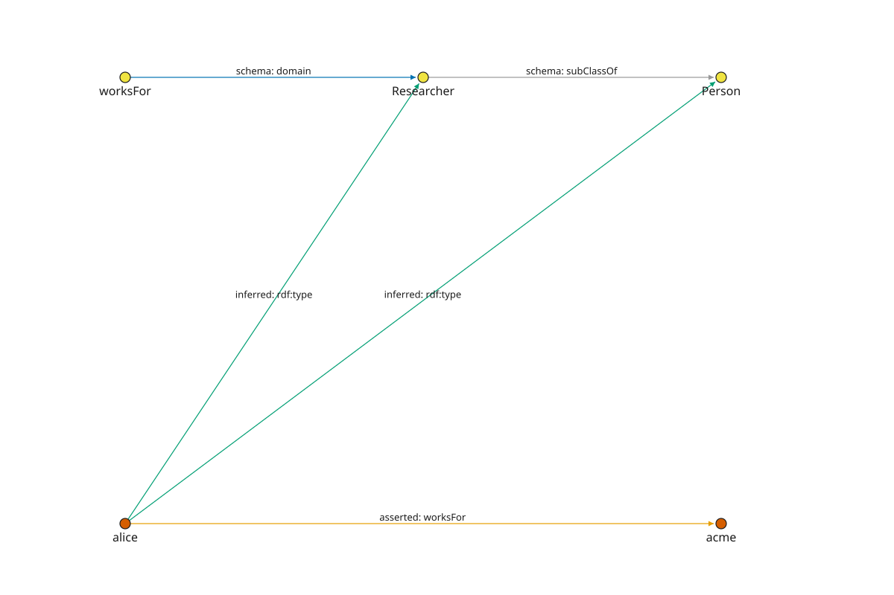

The gestalt-core-v1 fragment and its compiler
==============================================

``gestaltdb.ontology.model`` defines immutable axioms: ``SubClassOf``,
``SubPropertyOf``, ``EquivalentClasses/Properties``, ``Domain``, ``Range``,
``InverseOf``, ``Symmetric``, ``Transitive``, plus ``PropertyChain``,
``IntersectionSubClassOf`` / ``UnionSubClassOf`` (left-side only) and scoped
``Reflexive``. ``PROFILE = "gestalt-core-v1"``. Each axiom carries a content
``axiom_id`` (``sha256`` over ``["gestaltdb-axiom-v1", signature]``).

``compile_ontology(Ontology(id, axioms))`` (``ontology/compiler.py``) lowers
each axiom to safe positive Horn rules with ``rule_id =
ontology:{axiom_id}:{direction}`` and a ``RuleOrigin`` row per rule. The
``CompiledOntology`` checks that origins cover exactly the source axioms.

.. math::

   \frac{(x, \texttt{rdf:type}, C)}{(x, \texttt{rdf:type}, D)}
   \quad (C \sqsubseteq D) \qquad
   \frac{(x, p, y)}{(x, q, y)} \quad (p \sqsubseteq q) \qquad
   \frac{(x, p, y)\;\;(y, p, z)}{(x, p, z)} \quad (\text{Transitive}(p))

Rejected (fail closed): disjunctive heads, unscoped reflexivity, chains of
length != 2, ``rdf:type`` as a property, right-side unions. This is *not* full
RDFS/OWL — see :doc:`ontology <../ontology>` and gated profile work (#184,
#185).

Theory and further reading
---------------------------

- `Description logic <https://en.wikipedia.org/wiki/Description_logic>`_
  studies the decidable fragments of first-order logic behind OWL
  (``ALC``, ``SHOIN``, ``SROIQ``). Gestalt-core-v1 admits only its selected
  finite Horn rewrites, which is why this
  fragment needs no tableau reasoner.
- `Web Ontology Language
  <https://en.wikipedia.org/wiki/Web_Ontology_Language>`_ (`OWL 2 overview
  <https://www.w3.org/TR/owl2-overview/>`_) standardizes the full vocabulary
  (including existentials, cardinality, and keys). The named-entity compiler
  used here does not support that whole vocabulary. Separate experimental
  modules do not expand its contract: consult :doc:`../reasoning-profiles`
  and :doc:`../reasoning-el` rather than assuming full OWL support.
- `Horn clause <https://en.wikipedia.org/wiki/Horn_clause>`_ — at most one
  positive literal — is the logical shape every compiled rule must have.
  Disjunctive conclusions are not single-head Horn rules. Unscoped
  reflexivity is a different restriction: it needs an explicit finite domain
  of individuals here, not a different logical clause shape.

**Intuition.** Read the picture below in two groups: blue is *data*
(what someone asserted), purple is *schema* (what the arrows mean).
``domain`` says "anything a ``worksFor`` arrow leaves is a ``Researcher``";
``subClassOf`` says "every ``Researcher`` is also a ``Person``". The
``inferred type`` arrows are computed consequences, not stored labels. Both
``Researcher`` and ``Person`` memberships follow from the one asserted
``worksFor`` fact:

   Schema and data are visually separate; memberships are computed in this
   example, not written back. Explicit publication is a separate API.

.. code-block:: python

   from gestaltdb.ontology import Ontology, SubClassOf, Domain, compile_ontology
   from gestaltdb.reasoning import DatalogEngine, Fact, ReasoningLimits
   from gestaltdb.ontology import TYPE_PREDICATE

   plan = compile_ontology(Ontology("people", [
       Domain("worksFor", "Researcher"),
       SubClassOf("Researcher", "Person"),
   ]))
   asserted = Fact("alice", "worksFor", "acme")
   result = DatalogEngine().evaluate(
       plan.program, [asserted],
       limits=ReasoningLimits(), collect_proofs=True)
   researcher = Fact("alice", TYPE_PREDICATE, "Researcher")
   person = Fact("alice", TYPE_PREDICATE, "Person")
   assert result.facts == tuple(sorted((asserted, researcher, person)))
   assert not result.explain(person).truncated
   assert {origin.axiom_id for origin in plan.origins} == {
       axiom.axiom_id for axiom in plan.ontology.axioms
   }

Read this as a two-step explanation: the domain rule derives ``Researcher``;
the subclass rule uses it to derive ``Person``. ``result`` retains the asserted
fact as well as both conclusions. Its explanation is one bounded witness,
not a complete inventory of alternative supports for deletion maintenance.

.. note::

   Domain is an implication, not an input-validation constraint. An untyped
   subject of ``worksFor`` gains ``Researcher`` membership; it is not rejected
   for lacking that label. Short names in this example are exact local symbols:
   ``Person`` and ``person`` are different constants, and only ``TYPE_PREDICATE``
   supplies the full reserved ``rdf:type`` IRI.
