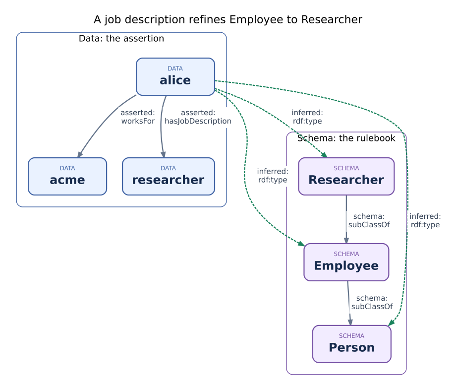

An ontology turns vocabulary into implications
===============================================

Why a schema is more than a set of labels
-----------------------------------------

Chapter 1 stored an employee but could not retrieve her as a person. The missing
piece is not another index: it is a statement that every employee is a person.
An **ontology** makes statements about the modeled vocabulary. Its **axioms**
are assumptions the reasoner may use, not observations it discovered itself.

Our two axioms are intentionally small:

* ``Domain("worksFor", "Employee")``: the subject of an employment
  ``worksFor`` statement belongs to ``Employee``.
* ``SubClassOf("Employee", "Person")``: every instance of ``Employee``
  also belongs to ``Person``. It says nothing about whether every person is a
  employee; implication is directional. Employment does not establish a job role.

Schema statements like these are often called the **TBox** (terminological
knowledge); statements about Alice and Acme are the **ABox** (assertional
knowledge). These are useful conceptual roles, not necessarily two physical
databases. An RDF graph can contain both kinds of statement.

Reading the notation
---------------------

``(alice, worksFor, acme)`` is a triple. ``(x, rdf:type, Employee)`` is a
pattern with a variable ``x``. When ``x = alice``, the pattern becomes a ground
statement: there are no variables left. In formulas, ``rdf:type`` abbreviates
the full reserved IRI supplied by ``TYPE_PREDICATE`` in Python.

``C ⊑ D`` reads "class C is a subclass of class D." An inference bar reads
"if the statements above the line hold, conclude the statement below it":

.. math::

   \frac{(x, \texttt{rdf:type}, C)}{(x, \texttt{rdf:type}, D)}
   \quad (C \sqsubseteq D) \qquad
   \frac{(x, p, y)}{(x, q, y)} \quad (p \sqsubseteq q) \qquad
   \frac{(x, p, y)\;\;(y, p, z)}{(x, p, z)} \quad (\text{Transitive}(p))

Read the three cases as membership inheritance, property inclusion, and
transitivity. In the last case, joining ``x → y`` to ``y → z`` on the shared
``y`` permits ``x → z`` *only because p is declared transitive*. The mere
existence of a two-hop path does not make every relationship transitive.

From one assertion to two consequences
--------------------------------------

**Intuition.** Read the picture below in two groups: blue is *data*
(what someone asserted), purple is *schema* (what the arrows mean).
``domain`` says "anything a ``worksFor`` arrow leaves is an ``Employee``";
``subClassOf`` says "every ``Employee`` is also a ``Person``". The
``inferred type`` arrows are computed consequences, not stored labels. Both
``Employee`` and ``Person`` memberships follow from the one asserted
``worksFor`` fact:

.. figure:: figures/subsumption-example.svg
   :width: 100%
   :alt: Employment plus domain Employee and Employee subclass Person infer Alice's Employee and Person memberships, not Researcher

   Schema and data are visually separate; memberships are computed in this
   example, not written back. Explicit publication is a separate API.

.. code-block:: python

   from gestaltdb.ontology import Ontology, SubClassOf, Domain, compile_ontology
   from gestaltdb.reasoning import DatalogEngine, Fact, ReasoningLimits
   from gestaltdb.ontology import TYPE_PREDICATE

   plan = compile_ontology(Ontology("people", [
       Domain("worksFor", "Employee"),
       SubClassOf("Employee", "Person"),
   ]))
   asserted = Fact("alice", "worksFor", "acme")
   result = DatalogEngine().evaluate(
       plan.program, [asserted],
       limits=ReasoningLimits(), collect_proofs=True)
   employee = Fact("alice", TYPE_PREDICATE, "Employee")
   person = Fact("alice", TYPE_PREDICATE, "Person")
   assert result.facts == tuple(sorted((asserted, employee, person)))
   assert Fact("alice", TYPE_PREDICATE, "Researcher") not in result
   assert not result.explain(person).truncated

Read this as a two-step explanation: the domain rule derives ``Employee``;
the subclass rule uses it to derive ``Person``. ``result`` retains the asserted
fact as well as both conclusions. Its explanation is one bounded witness,
not a complete inventory of alternative supports for deletion maintenance.

.. note::

   Domain is an implication, not an input-validation constraint. An untyped
   subject of ``worksFor`` gains ``Employee`` membership; it is not rejected
   for lacking that label. Short names in this example are exact local symbols:
   ``Person`` and ``person`` are different constants, and only ``TYPE_PREDICATE``
   supplies the full reserved ``rdf:type`` IRI.

Refinement needs evidence about the job
----------------------------------------

Calling every employee a researcher would encode a false assumption as an
axiom. Instead, place ``Researcher`` *below* ``Employee`` in the class
hierarchy. This states that researchers are employees in this model; it does
not classify all employees as researchers. We use ``Researcher`` here as an
employment-role class, not a claim that all research activity requires employment.

Now introduce a separate relation, ``hasJobDescription``. For this exercise its
object is the named category ``researcher`` or ``not_researcher``. These are
entity symbols in the binary engine, not datatype literals, and the lowercase
category ``researcher`` is not the class ``Researcher``. To classify an employee,
we need a rule that joins *their* membership with *their* research-job evidence:

.. math::

   \mathrm{type}(x,\mathrm{Employee}) \land
   \mathrm{hasJobDescription}(x,\mathrm{researcher})
   \;\Rightarrow\; \mathrm{type}(x,\mathrm{Researcher})

This value-sensitive condition is not a plain domain axiom: the domain would
apply to **every** job description, including ``not_researcher``. The selected
ontology compiler does not offer an arbitrary OWL value restriction for this
case, so we add an explicit safe binary rule. Chapter 3 explains its notation
and evaluation in depth.

.. code-block:: python

   from gestaltdb.reasoning import Atom, Program, Rule, Variable

   refined = compile_ontology(Ontology("employment-roles", [
       *plan.ontology.axioms, SubClassOf("Researcher", "Employee"),
   ]))
   x = Variable("x")
   research_job = Rule("employee-with-research-job", [
       Atom(x, TYPE_PREDICATE, "Employee"),
       Atom(x, "hasJobDescription", "researcher"),
   ], Atom(x, TYPE_PREDICATE, "Researcher"))
   program = Program([*refined.program.rules, research_job])
   engine = DatalogEngine()
   researcher = Fact("alice", TYPE_PREDICATE, "Researcher")
   assert researcher not in engine.evaluate(program, [asserted], limits=ReasoningLimits())
   with_job = engine.evaluate(program, [
       asserted, Fact("alice", "hasJobDescription", "researcher"),
   ], limits=ReasoningLimits(), collect_proofs=True)
   assert all(fact in with_job for fact in (employee, person, researcher))
   other_job = engine.evaluate(program, [
       asserted, Fact("alice", "hasJobDescription", "not_researcher"),
   ], limits=ReasoningLimits())
   assert employee in other_job and researcher not in other_job
   job_alone = engine.evaluate(program, [
       Fact("alice", "hasJobDescription", "researcher"),
   ], limits=ReasoningLimits())
   assert employee not in job_alone and researcher not in job_alone

The last case matters: a category record alone is not evidence of an actual
employment relationship. Equally, no description at all is not evidence for the
``not_researcher`` category. That category is an explicit positive classification
in this exercise, not logical negation. The program does not enforce that only
one category may be recorded; contradictory or overlapping descriptions need
a separately stated validation policy.

   A further refinement: the Researcher membership now depends on an additional
   asserted job description, not merely on ``worksFor``.

How much of the domain have we actually defined?
------------------------------------------------

"An employee is a person who participates in gainful employment" is a richer
conceptual definition than ``Employee`` subclass ``Person``. A fuller model could
give an employment activity its own identity, connect the person and employer
to that activity, and attach the job description, pay, and validity to it. This
also handles one person holding different roles at different companies.

``Employee`` subclass ``Person`` is therefore a necessary-condition statement,
not a complete if-and-only-if definition of gainful employment. Deriving the
class membership does not construct an employment activity, a company, or a
job-description record. The direct ``hasJobDescription`` relation is a
simplification for one current job; in the richer model the description would
belong to a particular employment activity rather than globally to the person.

The examples stop short of that reification. They treat ``worksFor`` as supplied
evidence of employment, rather than inferring gainful activity from physical
co-location. Visiting or working inside a company's building is not sufficient
by itself. Likewise, typing ACME as a ``Company`` requires an assertion or an
explicit range rule; its name does not supply that fact. These are deliberate
modeling boundaries, not facts a reasoner can guess.

What compilation contributes
-----------------------------

The ontology is convenient for expressing domain meaning; the evaluator needs
executable rules. ``compile_ontology`` is the bridge. It rewrites the two axioms
into "if worksFor, infer Employee" and "if Employee, infer Person," retaining
an origin mapping from generated rules back to source axioms. That mapping is
useful when explaining *which modeling assumption* produced an answer.

The selected ``gestalt-core-v1`` fragment includes subclass/subproperty,
equivalence, domain/range, inverse, symmetric and transitive properties,
binary property chains, selected left-side class expressions, and scoped
reflexivity. It is not full RDFS or OWL. Disjunctive conclusions, arbitrary
anonymous restrictions, longer property chains, and unscoped reflexivity must
not be inferred from the fact that the engine supports simpler forms. See
:doc:`ch08-gaps` for boundaries and :doc:`../ontology` for API details.

Theory and further reading
---------------------------

* `OWL 2 overview <https://www.w3.org/TR/owl2-overview/>`_ introduces the wider
  ontology language. Supporting some OWL-shaped axioms is not the same as
  implementing every OWL profile.
* `Description logic <https://en.wikipedia.org/wiki/Description_logic>`_
  provides the foundation for much ontology reasoning, including languages
  with richer class expressions than this tutorial's named-class fragment.
* `Horn clause <https://en.wikipedia.org/wiki/Horn_clause>`_ explains the
  single-conclusion rule shape used by this compiler. The next chapter explains
  how an engine evaluates such rules, rather than treating them as magic.

Check your understanding
-------------------------

**Question.** If we remove the domain axiom, does ``SubClassOf(Employee,
Person)`` alone still imply that Alice is a person from the ``worksFor`` fact?
What if we instead assert Alice's ``Employee`` membership directly? Does either
case establish that her job is research?

**Answer.** The first inference no longer follows: nothing supplies the
``Employee`` premise. The second does follow, because the asserted membership
is enough to trigger the subclass implication. A rule does not manufacture its
own missing premise. Neither case establishes a research job without the
additional job evidence and classification rule.
