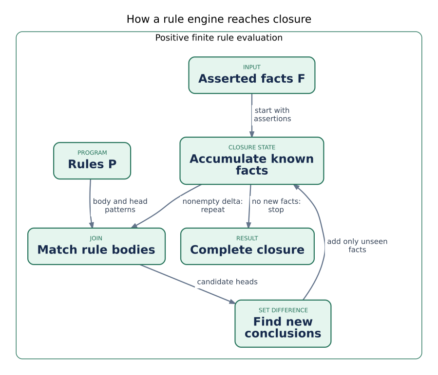

How a reasoning engine works
=============================

Why not just write another Python loop?
---------------------------------------

For two implications, a hand-written ``if`` statement seems sufficient. The
problem appears when one conclusion becomes another rule's input, a hierarchy
gets deeper, several applications share the same policy, or an answer needs an
explanation. A loop can implement all this, but then *you* must decide which
joins to repeat, suppress duplicates, terminate recursion, and track why each
answer exists. Those are the responsibilities a reasoning engine makes reusable.

A rule separates a statement of intended meaning from an execution strategy.
The same subclass rule can classify people from many datasets; the engine
decides which facts to inspect and how to reuse results. The benefit is not
merely less code. Search can include indirectly classified entities, dependency
analysis can discover effects several steps away, and an explanation can name
the assumptions behind a result. The cost is additional computation, memory,
and responsibility for the validity of the rules.

This chapter introduces one important family: **finite positive Datalog**.
It is enough for the selected ontology compiler, but it is not a synonym for
every kind of reasoning. An engine for arbitrary OWL class expressions, an
answer-set solver, and a Prolog interpreter need not accept the same language
or compute the same kind of answer.

From a sentence to a rule
--------------------------

Write ``worksFor(alice, acme)`` as a convenient relation notation for the triple
``(alice, worksFor, acme)``. ``worksFor`` is the **predicate**, and ``alice`` and
``acme`` are **constants** denoting particular entities. An **atom** such as
``worksFor(x, y)`` may contain variables. A **fact** is a ground atom: no
variables remain to be assigned.

Now suppose the graph also states that Acme is located in Athens. We want to
derive Alice's work location, under the explicit simplifying assumption that a
employment relationship inherits its organization's location:

.. math::

   \mathrm{worksFor}(x,y) \land \mathrm{locatedIn}(y,z)
   \;\Rightarrow\; \mathrm{worksIn}(x,z)

The left side is the **body**, the right side the **head**. The symbol ``∧``
means "and"; ``⇒`` means "implies." All variables are implicitly universally
quantified: *for every* assignment to ``x``, ``y``, and ``z``, if both premises
hold, the conclusion holds. Datalog texts often reverse the typography::

   worksIn(x, z) :- worksFor(x, y), locatedIn(y, z).

Read ``:-`` as "if" and the comma as conjunction. This is explanatory notation,
not a textual parser exposed by the GestaltDB examples below. Python code uses
``Rule`` and ``Atom`` values. A ``Variable("x")`` denotes a variable; the plain
string ``"x"`` remains a constant.

Matching a rule is a join
--------------------------

The repeated ``y`` is the important part. It requires *the same organization*
in both premises. In database language this is an equijoin. A fact about Bob
working for a different organization must not combine with Acme's location
merely because the two relations are nonempty.

The assignment ``σ = {x ↦ alice, y ↦ acme, z ↦ athens}`` is a **substitution**.
Applying it to the body gives two ground premises that can be checked against
the known facts; applying it to the head gives ``worksIn(alice, athens)``.
With a large dataset, finding these assignments efficiently is most of the
work. Binding ``y`` to Acme before looking up ``locatedIn`` avoids scanning
every organization's location for every employee.

A rule is **safe** here when every head variable also occurs in its positive
body. ``worksIn(x, z) :- worksFor(x, y)`` would leave ``z`` unconstrained. It
does not specify which place to invent, so this engine rejects it rather than
guessing. Safety is one reason the supported rule language is deliberately
smaller than unrestricted first-order logic.

Why recursion needs a fixed point
---------------------------------

One join answers a two-relation question. It does not by itself answer "Which
larger organizations contain Acme, however deep the hierarchy?" For that, let
``partOf`` be transitive:

.. math::

   \mathrm{partOf}(x,y) \land \mathrm{partOf}(y,z)
   \;\Rightarrow\; \mathrm{partOf}(x,z)

Acme may be part of a group, the group part of a university, and the university
part of a federation. Newly discovered containment facts can be used by the
same rule again. This is recursion over a relation, not necessarily a recursive
Python function. A single pass in a fixed order is not a general solution.

An engine accumulates facts until another round adds nothing. Define the
input set as ``F``, the rules as ``P``, and the accumulated set after round
``n`` as ``I_n``:

.. math::

   I_0 = F, \qquad
   I_{n+1} = I_n \cup \{\, h\sigma \mid (B \Rightarrow h) \in P,
                        \;B\sigma \subseteq I_n\,\}, \qquad
   C_P(F) = \bigcup_{n \ge 0} I_n

``Bσ ⊆ I_n`` says that *every* substituted body atom is already known. The
union retains old facts while adding conclusions. ``C_P(F)`` is the **closure**:
all assertions plus their consequences in this fragment. For chapter 2, the
initial set contains ``worksFor(alice, acme)``, the next adds Employee
membership, the next adds Person membership, and the following adds nothing.

This is a **least fixed point**: the smallest closed set containing the input,
not a collection of arbitrary additional truths. With finitely many constants,
fixed predicate arities, and no operations that generate fresh values, only
finitely many distinct facts can appear. Set semantics prevents repeated
derivations from growing the set forever. Cyclic rules can rediscover facts;
they do not create an infinite list of duplicate answers.

   The evaluation loop. Begin with the assertions, repeat only while new facts
   are found, and report complete closure only after the stopping condition.

.. note::

   The termination argument is for this finite positive fragment. Arithmetic
   that generates unbounded values or existential rules that create fresh
   individuals need different guarantees. "It looks like Datalog" is not a
   proof of termination for every language extension.

Try a join and a recursive rule
-------------------------------

The following program expresses both operations directly. It does not need
an ontology compiler or database backend, demonstrating that a reasoning
engine and a graph database are separable components.

.. code-block:: python

   from gestaltdb.reasoning import (
       Atom, DatalogEngine, Fact, Program, ReasoningLimits, Rule, Variable,
   )

   x, y, z = Variable("x"), Variable("y"), Variable("z")
   program = Program([
       Rule("work-location", [Atom(x, "worksFor", y), Atom(y, "locatedIn", z)],
            Atom(x, "worksIn", z)),
       Rule("containment", [Atom(x, "partOf", y), Atom(y, "partOf", z)],
            Atom(x, "partOf", z)),
   ])
   facts = [
       Fact("alice", "worksFor", "acme"),
       Fact("acme", "locatedIn", "athens"),
       Fact("acme", "partOf", "group"),
       Fact("group", "partOf", "university"),
       Fact("university", "partOf", "federation"),
   ]
   result = DatalogEngine().evaluate(
       program, facts, limits=ReasoningLimits(), collect_proofs=True)
   assert result.match(predicate="worksIn") == (
       Fact("alice", "worksIn", "athens"),)
   assert Fact("acme", "partOf", "federation") in result
   assert not result.explain(Fact("acme", "partOf", "federation")).truncated

What makes the answer trustworthy?
-----------------------------------

The notation :math:`F \cup P \models q` reads "the assertions and rules entail q": every
interpretation satisfying those assumptions also satisfies the conclusion.
The engine computes consequences; it does not establish that the assertions
or modeling assumptions describe the real world correctly. Our work-location
rule, for example, is unsuitable for remote workers unless the model accounts
for them.

An evaluator is **sound** for a fragment if every answer it produces follows
under that fragment's semantics. It is **complete** for a fragment if it can
produce every required answer. These qualifications matter: completeness for
safe positive binary rules is not completeness for OWL DL or arbitrary Python
conditions. Resource limits are also distinct from semantics. A limit failure
must not masquerade as a complete successful closure.

An explanation provides another kind of assurance: it lets a reader inspect
the actual premises and rule used. That is why the examples collect proofs.
One chosen witness is useful for auditing an answer, but it is not all possible
supports. If a premise is deleted, a second independent derivation may still
justify the answer. Chapter 5 returns to that distinction.

Avoiding unnecessary work
--------------------------

A naive implementation repeats all joins after every round. **Semi-naive**
evaluation instead uses the latest additions, called the delta ``Δ``, in at
least one body occurrence of each newly relevant join. The other occurrences
may use the accumulated facts. Joining only new facts with new facts would be
incorrect: a new employment fact must still join an old location fact.
Subtracting already-known conclusions gives the next delta.

Not every rule needs to run in one global loop. An engine can form a dependency
graph of predicates and find **strongly connected components** (SCCs): groups
that can recursively depend on themselves. Prepared plans use such groups to
schedule recursion and reuse dispatch information. This is the same general
idea as identifying loops in a compiler's control-flow analysis. Planning
does not change the intended answers, and plan construction itself costs time.

Full closure is useful when many later queries reuse its results. If the only
question is about Alice, deriving every person's work location may be wasted
effort. A **goal-directed** strategy starts from the question. GestaltDB's
demand API uses magic-set specialization for its supported positive fragment:
bindings from the goal restrict which derivations are needed. That is not a
promise that every query becomes faster, nor that storage extraction is always
pushed down to the smallest possible KV read.

Why intermediate representations exist
---------------------------------------

A domain author wants to write ``SubClassOf``; a join operator wants indexed
relations or integer columns. These are different views of the same task.
An **intermediate representation** (IR) makes each boundary explicit. The
ontology compiler produces ``Program``/``Rule``/``Atom`` values; a prepared
plan adds an execution schedule; a compact batch stores relation rows in
columns. Inspecting these layers explains both answers and costs without
requiring one representation to serve every purpose.

Replacing the repeated symbol ``alice`` with an integer can reduce payload and
comparison costs, but that integer has meaning only with its exact dictionary.
Two snapshots may assign different numbers to Alice. This is why dictionary
and context identity are part of compact-batch contracts, not optional metadata.
Arrow can exchange those columns; Polars can execute selected columnar joins.
Neither transport nor compactness supplies logical semantics, proofs, or
maintenance automatically. The default binary evaluator remains indexed
Python; the Polars path is explicitly selected and closure-only.

To inspect these boundaries in GestaltDB, continue with :doc:`../reasoning-plans`,
:doc:`../reasoning-batches`, and :doc:`../reasoning-demand`. The typed n-ary
engine is a separate API (:doc:`../reasoning-typed`), not an implicit upgrade of
the binary ontology program used here.

Other engines: similar notation, different jobs
-----------------------------------------------

`Soufflé <https://souffle-lang.github.io/tutorial>`_ is a useful comparison for
bottom-up Datalog and recursive program analysis. It can compile programs to
native executables and emphasizes relation processing and profiling. Its
practical language has extensions beyond finite pure Datalog; its own tutorial
explains why value-generating arithmetic can break termination. The connection
to GestaltDB is the relational/fixpoint model, not an identical API, performance
profile, or language contract.

`SWI-Prolog's tabled execution <https://www.swi-prolog.org/pldoc/man?section=tabling>`_
illustrates a different route to recursive answers: goal-directed evaluation
with memoized answers and suspended recursive calls. Ordinary depth-first
Prolog search can loop on some recursive definitions; tabling changes that
behavior for appropriate programs. It would be misleading to describe all
Prolog engines as naive depth-first search, or all goal-directed reasoning as
GestaltDB's magic-set strategy.

`Clingo <https://potassco.org/clingo/>`_ combines a grounder and an answer-set
solver. It is relevant when the problem includes choices, constraints, and
alternative solutions, such as allocating resources under restrictions. Such
a program can have no stable model or several; that is not the same output
contract as one positive Datalog closure. GestaltDB uses Clingo in selected
comparative benchmarks, not as the default runtime or as proof of equivalent
support for answer-set programming.

`Apache Jena's inference API <https://jena.apache.org/documentation/inference/>`_
shows how an RDF system can expose an inference model through which queries
see deductions as well as base statements. Jena documents different reasoners,
rule-engine strategies, and coverage limits. GestaltDB instead makes its
database-to-reasoner and result-consumption boundaries explicit. The comparison
helps explain an integration choice, not a claim that either system implements
every OWL construct.

The practical lesson is to choose an engine by **the questions and semantics
required**, then assess execution and integration. Similar-looking rule syntax
does not establish interchangeability. None of these external engines is a
required dependency for the examples in this chapter.

Check your understanding
-------------------------

**Question.** Why must a new ``worksFor(alice, acme)`` fact join an *old*
``locatedIn(acme, athens)`` fact? Would a query about Alice require computing
every organization's transitive closure?

**Answer.** The body is satisfied regardless of the premises' arrival order;
semi-naive evaluation therefore combines a delta occurrence with accumulated
relations. A supported demand strategy can restrict work relevant to Alice,
while a full materialization deliberately computes reusable closure. Those
are execution choices, not different meanings of the positive rule.

Theory behind the explanations
-------------------------------

`Datalog <https://en.wikipedia.org/wiki/Datalog>`_ gives the language background.
The `least fixed point <https://en.wikipedia.org/wiki/Least_fixed_point>`_ and
`Knaster–Tarski theorem <https://en.wikipedia.org/wiki/Knaster%E2%80%93Tarski_theorem>`_
explain why monotone consequence operators have least fixed points; finiteness
additionally makes the iteration above terminate. `Magic sets
<https://en.wikipedia.org/wiki/Magic_sets>`_ gives the rewriting background for
selective evaluation. These are foundations, not speedup guarantees.
