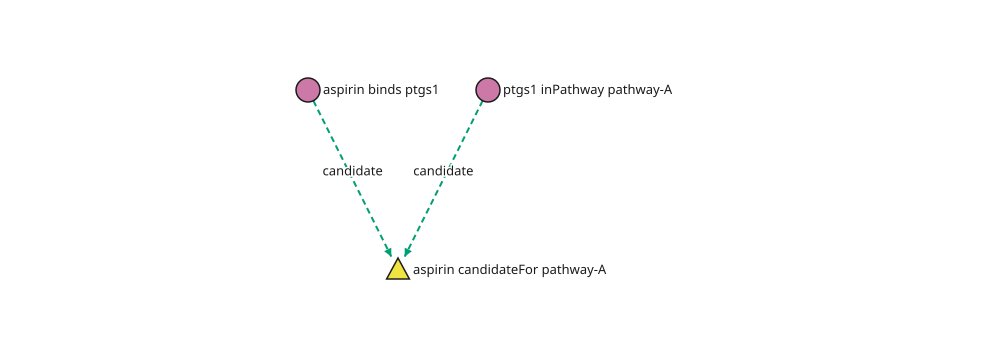

Facts, Rules, and Explanations
==============================

Use standalone reasoning when you want to state **what follows from selected
facts**, rather than query only stored graph records. No database is required.
A :term:`Datalog` program contains rules; the evaluator applies them to input
facts and returns their :term:`closure`. It does not silently write conclusions
back to a database. The :doc:`glossary` explains unfamiliar terms throughout the
reasoning guides.

The vocabulary, before the code
--------------------------------

Consider two toy assertions: a drug binds a protein, and the protein is in a
pathway. Our example rule calls the drug a *candidate* for that pathway. This is
a synthetic reasoning example, not a claim of medical efficacy.

- A **fact** is concrete: ``binds(aspirin, ptgs1)``. ``binds`` is the
  **predicate** (relation name), and its two arguments make it **binary**.
- An **atom** is a relation pattern, such as ``binds(x, y)``. ``x`` and ``y``
  are variables; matching concrete facts binds them to values.
- A rule's **body** contains its premises. Its **head** is the conclusion.
  Shared variables require matching values in every premise.
- A **witness** is one recorded explanation of a conclusion: which rule and
  concrete premises produced it. It is not all possible explanations.

Read the rule below as “if x binds y and y is in pathway z, derive that x is a
candidate for z”:

.. math::

   \operatorname{candidateFor}(x,z) \leftarrow
   \operatorname{binds}(x,y) \land \operatorname{inPathway}(y,z).

``←`` means “follows from”; ``∧`` means both conditions hold. These predicates
and variables map directly to the Python rule objects in the example.

Run a rule and inspect one explanation
---------------------------------------

**Standalone runnable example.** The base installation is sufficient; no backend,
solver or visualization extra is required.

.. code-block:: python

   from gestaltdb.reasoning import (
       Atom, DatalogEngine, Fact, Program, ReasoningLimits, Rule, Variable,
   )
   from gestaltdb.viz.api import VizOptions, visualize_proof_explanation

   x, y, z = Variable("x"), Variable("y"), Variable("z")
   program = Program([
       Rule("candidate", [Atom(x, "binds", y), Atom(y, "inPathway", z)],
            Atom(x, "candidateFor", z)),
   ])
   facts = [Fact("aspirin", "binds", "ptgs1"), Fact("ptgs1", "inPathway", "pathway-A")]
   result = DatalogEngine().evaluate(
       program, facts, limits=ReasoningLimits(), collect_proofs=True,
   )
   conclusion = Fact("aspirin", "candidateFor", "pathway-A")
   assert conclusion in result
   explanation = result.explain(conclusion)
   assert not explanation.truncated

   figure = visualize_proof_explanation(
       explanation, options=VizOptions(node_label_property="label", edge_labels="all"),
   )
   svg = figure.as_svg(width=1000, height=360)
   assert "candidateFor" in svg

In the binary API, ``Fact`` and ``Atom`` use **subject, predicate, object** order,
so ``Fact("aspirin", "binds", "ptgs1")`` expresses
``binds(aspirin, ptgs1)``. Variables are explicit ``Variable`` values; the string
``"x"`` alone is a constant, not a variable.

   Generated by GestaltDB's ``visualize_proof_explanation`` from this rule and
   its evaluated explanation. Circles are input facts, the triangle is a derived
   conclusion, and dotted arrows name the deriving rule. Arrows are explanation
   dependencies, not physical graph relationships.

Use ``figure.save_svg(path)`` for static output or ``figure.save(path)`` for an
offline interactive HTML artifact. The figure above is committed static output;
Sphinx users do not need a running database or browser visualization application
to read it. See :doc:`visualization` for the full API.

Closure and the stopping point
--------------------------------

The returned closure contains input and derived facts under set semantics:
deriving the same logical fact again does not create another copy. Rules can
feed later rule applications. A **fixpoint** is reached when applying them again
adds no new facts. A **recursive** program reuses its own conclusions directly
or through other rules, for example to compute reachability.

This explains the semantics, not the evaluator's physical join order. The indexed
engine uses **delta** work (newly added facts) to avoid repeating every old
combination. ``ReasoningLimits`` bounds selected work/storage counts; it is not
an operating-system memory or time sandbox. Inference-limit exhaustion raises;
proof budgets can truncate explanation retention without removing conclusions.

Witnesses are not all supports
--------------------------------

Suppose another protein independently justifies the same candidate conclusion.
There are now two **supports**. The displayed witness can show one of them, so
removing that displayed path does not by itself prove the conclusion must go away.
All-support maintenance is a separate capability (:doc:`reasoning-maintenance`).

Larger explanations can share premises in a **DAG** (directed acyclic graph)
rather than duplicate them in a tree. A retained witness belongs to its evaluated
program and input horizon. Reevaluate or use the appropriate maintenance API
after support changes; do not treat an old explanation as current evidence.
Bounds, exports and checkpoint distinctions are in :doc:`reasoning-proofs`.

Choose the next reasoning capability
------------------------------------

- **Values and n-ary relations:** :doc:`reasoning-typed` adds strict literals,
  comparisons, multi-head normalization and restricted aggregates. **Arity** means
  the number of arguments; a **literal** is typed data rather than an entity name.
- **Absence:** :doc:`reasoning-negation` requires declared closed scopes and
  stratification. Missing positive input is not an explicit negative claim.
- **Ontology:** :doc:`ontology` compiles selected semantic axioms into programs.
  Classifying an entity is different from validating required fields.
- **Selective answers:** :doc:`reasoning-demand` requests a goal instead of the
  full closure.
- **Time intervals:** :doc:`reasoning-temporal` computes when conclusions hold,
  separately from storing temporal graph history.
- **Stored database rules:** ``graph.rules`` operates on selected temporal claims,
  not on this standalone program API (:doc:`temporal-versioning`).

For optional background, see `Datalog <https://en.wikipedia.org/wiki/Datalog>`_
and the linked terms in :doc:`glossary`. GestaltDB's own guides, rather than an
external language description, define the supported fragment.
